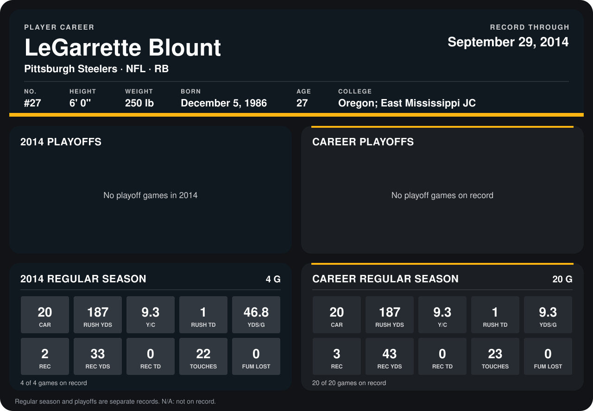

# LeGarrette Blount

## Career stats

### Regular season

| Season | Club | G | CAR | RUSH YDS | Y/C | RUSH TD | YDS/G | REC | REC YDS | REC TD | TOUCHES | FUM LOST |
|---|---|---:|---:|---:|---:|---:|---:|---:|---:|---:|---:|---:|
| 2013 | New England Patriots | 16 | 0 | 0 | N/A | 0 | 0.0 | 1 | 10 | 0 | 1 | 0 |
| 2014 | Pittsburgh Steelers | 5 | 24 | 196 | 8.2 | 1 | 39.2 | 3 | 36 | 0 | 27 | 0 |
| **Career** |  | 21 | 24 | 196 | 8.2 | 1 | 9.3 | 4 | 46 | 0 | 28 | 0 |

### Playoffs

No playoff games on record.

## Awards

None on record.

Records through October 5, 2014. Identity: listed 2014 roster data, Weeks 1-4; number: 2014 Week 1 roster. [All Pittsburgh Steelers players](README.md).
