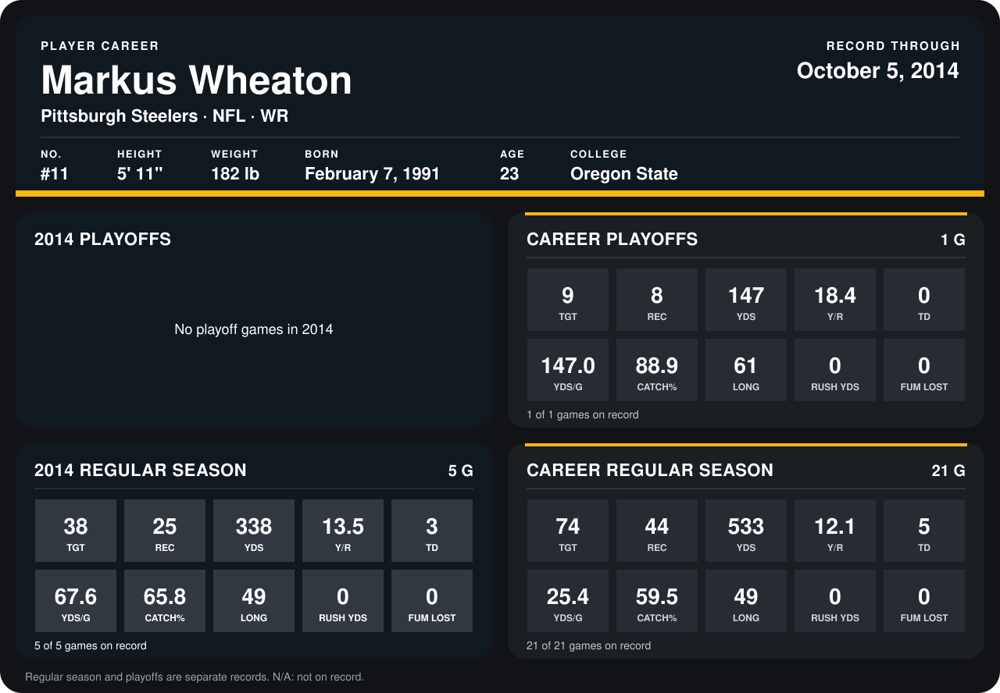

# Markus Wheaton

## Career stats

### Regular season

| Season | Team | Age | # | G | TGT | REC | YDS | Y/R | TD | YDS/G | CATCH% | LONG | RUSH YDS | FUM LOST |
|---|---|---:|---:|---:|---:|---:|---:|---:|---:|---:|---:|---:|---:|---:|
| 2013 | Pittsburgh Steelers | 22 | 11 | 16 | 36 | 19 | 195 | 10.3 | 2 | 12.2 | 52.8 | 24 | 0 | 0 |
| 2014 | Pittsburgh Steelers | 23 | 11 | 5 | 38 | 25 | 338 | 13.5 | 3 | 67.6 | 65.8 | 49 | 0 | 0 |
| **Career** |  |  |  | 21 | 74 | 44 | 533 | 12.1 | 5 | 25.4 | 59.5 | 49 | 0 | 0 |

### Playoffs

| Season | Team | Age | # | G | TGT | REC | YDS | Y/R | TD | YDS/G | CATCH% | LONG | RUSH YDS | FUM LOST |
|---|---|---:|---:|---:|---:|---:|---:|---:|---:|---:|---:|---:|---:|---:|
| 2013 | Pittsburgh Steelers | 22 | 11 | 1 | 9 | 8 | 147 | 18.4 | 0 | 147.0 | 88.9 | 61 | 0 | 0 |
| **Career** |  |  |  | 1 | 9 | 8 | 147 | 18.4 | 0 | 147.0 | 88.9 | 61 | 0 | 0 |

## Awards

None on record.

Age is his age on the league's opening game of each season; # is the number listed for him that season with that team (2014: the card's rule; 2013: the 2013 season roster), N/A where no listing applies.

Records through October 5, 2014. Identity: listed 2014 roster data, Weeks 1-4; number: 2014 Week 1 roster. [All Pittsburgh Steelers players](README.md).
