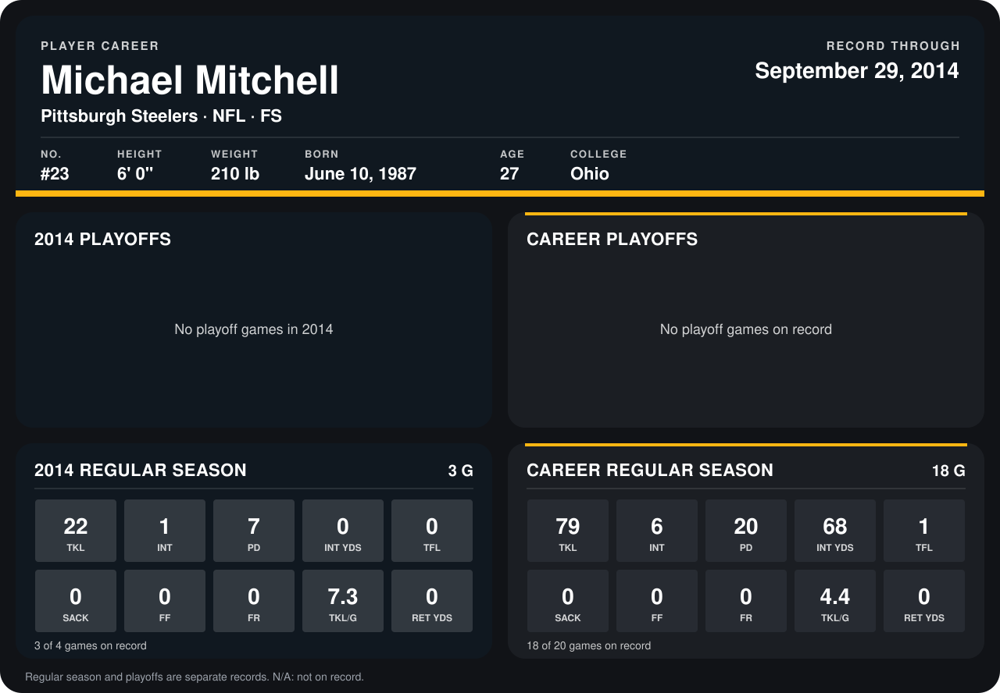

# Michael Mitchell

## Career stats

### Regular season

| Season | Club | G | TKL | INT | PD | INT YDS | TFL | SACK | FF | FR | TKL/G | RET YDS |
|---|---|---:|---:|---:|---:|---:|---:|---:|---:|---:|---:|---:|
| 2013 | Carolina Panthers | 15 | 57 | 5 | 13 | 68 | 1 | 0 | 0 | 0 | 3.8 | 0 |
| 2014 | Pittsburgh Steelers | 3 | 22 | 1 | 7 | 0 | 0 | 0 | 0 | 0 | 7.3 | 0 |
| **Career** |  | 18 | 79 | 6 | 20 | 68 | 1 | 0 | 0 | 0 | 4.4 | 0 |

### Playoffs

No playoff games on record.

## Awards

None on record.

Records through September 28, 2014. Identity: listed 2014 roster data, Weeks 1-4; number: 2014 Week 1 roster. [All Pittsburgh Steelers players](README.md).
