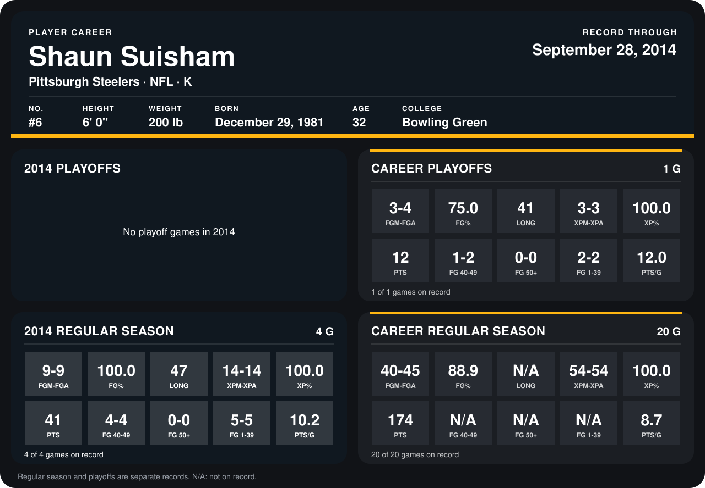

# Shaun Suisham

## Career stats

### Regular season

| Season | Team | Age | # | G | FGM-FGA | FG% | LONG | XPM-XPA | XP% | PTS | FG 40-49 | FG 50+ | FG 1-39 | PTS/G |
|---|---|---:|---:|---:|---:|---:|---:|---:|---:|---:|---:|---:|---:|---:|
| 2013 | Pittsburgh Steelers | 31 | 6 | 16 | 31-36 | 86.1 | N/A | 40-40 | 100.0 | 133 | N/A | N/A | N/A | 8.3 |
| 2014 | Pittsburgh Steelers | 32 | 6 | 4 | 9-9 | 100.0 | 47 | 14-14 | 100.0 | 41 | 4-4 | 0-0 | 5-5 | 10.2 |
| **Career** |  |  |  | 20 | 40-45 | 88.9 | N/A | 54-54 | 100.0 | 174 | N/A | N/A | N/A | 8.7 |

### Playoffs

| Season | Team | Age | # | G | FGM-FGA | FG% | LONG | XPM-XPA | XP% | PTS | FG 40-49 | FG 50+ | FG 1-39 | PTS/G |
|---|---|---:|---:|---:|---:|---:|---:|---:|---:|---:|---:|---:|---:|---:|
| 2013 | Pittsburgh Steelers | 31 | 6 | 1 | 3-4 | 75.0 | 41 | 3-3 | 100.0 | 12 | 1-2 | 0-0 | 2-2 | 12.0 |
| **Career** |  |  |  | 1 | 3-4 | 75.0 | 41 | 3-3 | 100.0 | 12 | 1-2 | 0-0 | 2-2 | 12.0 |

## Awards

None on record.

Age is his age on the league's opening game of each season; # is the number listed for him that season with that team (2014: the card's rule; 2013: the 2013 season roster), N/A where no listing applies.

Records through September 28, 2014. Identity: listed 2014 roster data, Weeks 1-4; number: 2014 Week 1 roster. [All Pittsburgh Steelers players](README.md).
