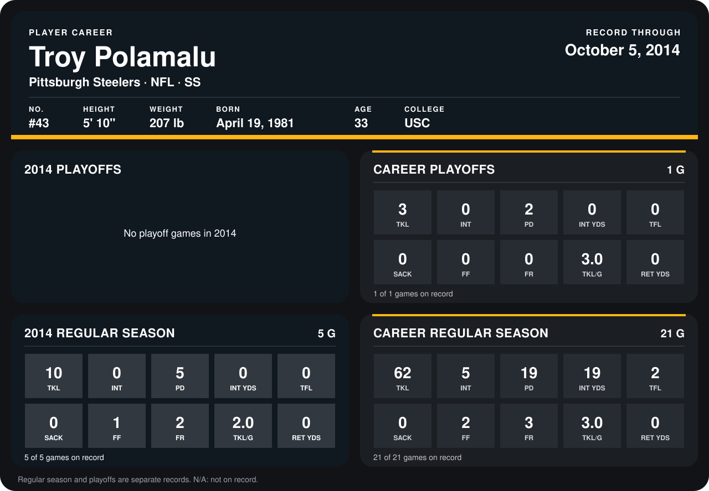

# Troy Polamalu

## Career stats

### Regular season

| Season | Team | Age | # | G | TKL | INT | PD | INT YDS | TFL | SACK | FF | FR | TKL/G | RET YDS |
|---|---|---:|---:|---:|---:|---:|---:|---:|---:|---:|---:|---:|---:|---:|
| 2013 | Pittsburgh Steelers | 32 | 43 | 16 | 52 | 5 | 14 | 19 | 2 | 0 | 1 | 1 | 3.2 | 0 |
| 2014 | Pittsburgh Steelers | 33 | 43 | 4 | 6 | 0 | 4 | 0 | 0 | 0 | 1 | 1 | 1.5 | 0 |
| **Career** |  |  |  | 20 | 58 | 5 | 18 | 19 | 2 | 0 | 2 | 2 | 2.9 | 0 |

### Playoffs

| Season | Team | Age | # | G | TKL | INT | PD | INT YDS | TFL | SACK | FF | FR | TKL/G | RET YDS |
|---|---|---:|---:|---:|---:|---:|---:|---:|---:|---:|---:|---:|---:|---:|
| 2013 | Pittsburgh Steelers | 32 | 43 | 1 | 3 | 0 | 2 | 0 | 0 | 0 | 0 | 0 | 3.0 | 0 |
| **Career** |  |  |  | 1 | 3 | 0 | 2 | 0 | 0 | 0 | 0 | 0 | 3.0 | 0 |

## Awards

None on record.

Age is his age on the league's opening game of each season; # is the number listed for him that season with that team (2014: the card's rule; 2013: the 2013 season roster), N/A where no listing applies.

Records through September 28, 2014. Identity: listed 2014 roster data, Weeks 1-4; number: 2014 Week 1 roster. [All Pittsburgh Steelers players](README.md).
