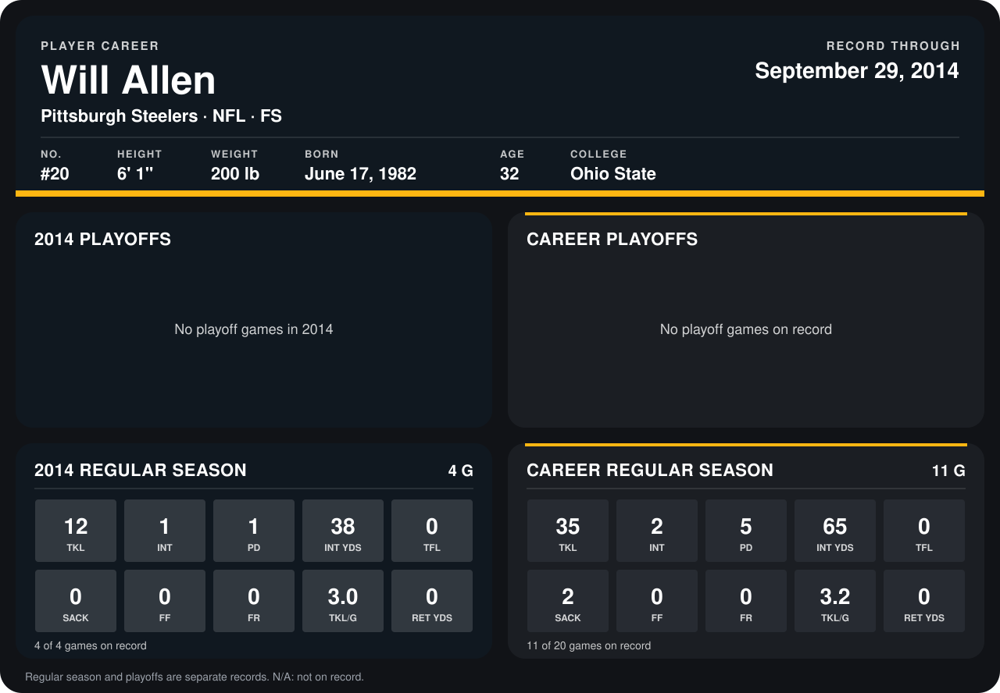

# Will Allen

## Career stats

### Regular season

| Season | Club | G | TKL | INT | PD | INT YDS | TFL | SACK | FF | FR | TKL/G | RET YDS |
|---|---|---:|---:|---:|---:|---:|---:|---:|---:|---:|---:|---:|
| 2013 | Dallas Cowboys | 7 | 23 | 1 | 4 | 27 | 0 | 2 | 0 | 0 | 3.3 | 0 |
| 2014 | Pittsburgh Steelers | 5 | 12 | 1 | 1 | 38 | 0 | 0 | 0 | 0 | 2.4 | 0 |
| **Career** |  | 12 | 35 | 2 | 5 | 65 | 0 | 2 | 0 | 0 | 2.9 | 0 |

### Playoffs

No playoff games on record.

## Awards

None on record.

Records through October 5, 2014. Identity: listed 2014 roster data, Weeks 1-4; number: 2014 Week 1 roster. [All Pittsburgh Steelers players](README.md).
