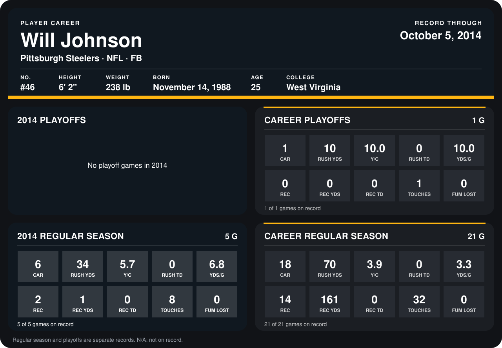

# Will Johnson

## Career stats

### Regular season

| Season | Team | Age | # | G | CAR | RUSH YDS | Y/C | RUSH TD | YDS/G | REC | REC YDS | REC TD | TOUCHES | FUM LOST |
|---|---|---:|---:|---:|---:|---:|---:|---:|---:|---:|---:|---:|---:|---:|
| 2013 | Pittsburgh Steelers | 24 | 46 | 16 | 12 | 36 | 3.0 | 0 | 2.2 | 12 | 160 | 0 | 24 | 0 |
| 2014 | Pittsburgh Steelers | 25 | 46 | 5 | 6 | 34 | 5.7 | 0 | 6.8 | 2 | 1 | 0 | 8 | 0 |
| **Career** |  |  |  | 21 | 18 | 70 | 3.9 | 0 | 3.3 | 14 | 161 | 0 | 32 | 0 |

### Playoffs

| Season | Team | Age | # | G | CAR | RUSH YDS | Y/C | RUSH TD | YDS/G | REC | REC YDS | REC TD | TOUCHES | FUM LOST |
|---|---|---:|---:|---:|---:|---:|---:|---:|---:|---:|---:|---:|---:|---:|
| 2013 | Pittsburgh Steelers | 24 | 46 | 1 | 1 | 10 | 10.0 | 0 | 10.0 | 0 | 0 | 0 | 1 | 0 |
| **Career** |  |  |  | 1 | 1 | 10 | 10.0 | 0 | 10.0 | 0 | 0 | 0 | 1 | 0 |

## Awards

None on record.

Age is his age on the league's opening game of each season; # is the number listed for him that season with that team (2014: the card's rule; 2013: the 2013 season roster), N/A where no listing applies.

Records through October 5, 2014. Identity: listed 2014 roster data, Weeks 1-4; number: 2014 Week 1 roster. [All Pittsburgh Steelers players](README.md).
