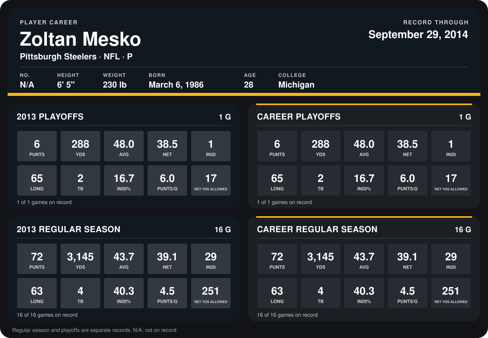

# Zoltan Mesko

## Career stats

### Regular season

| Season | Club | G | PUNTS | YDS | AVG | NET | IN20 | LONG | TB | IN20% | PUNTS/G | RET YDS ALLOWED |
|---|---|---:|---:|---:|---:|---:|---:|---:|---:|---:|---:|---:|
| 2013 | Pittsburgh Steelers | 16 | 72 | 3,145 | 43.7 | 39.1 | 29 | 63 | 4 | 40.3 | 4.5 | 251 |
| **Career** |  | 16 | 72 | 3,145 | 43.7 | 39.1 | 29 | 63 | 4 | 40.3 | 4.5 | 251 |

### Playoffs

| Season | Club | G | PUNTS | YDS | AVG | NET | IN20 | LONG | TB | IN20% | PUNTS/G | RET YDS ALLOWED |
|---|---|---:|---:|---:|---:|---:|---:|---:|---:|---:|---:|---:|
| 2013 | Pittsburgh Steelers | 1 | 6 | 288 | 48.0 | 38.5 | 1 | 65 | 2 | 16.7 | 6.0 | 17 |
| **Career** |  | 1 | 6 | 288 | 48.0 | 38.5 | 1 | 65 | 2 | 16.7 | 6.0 | 17 |

## Awards

None on record.

Records through September 29, 2014. Identity: the public player file's latest listing (no 2014 Weeks 1-4 roster row). [All Pittsburgh Steelers players](README.md).
