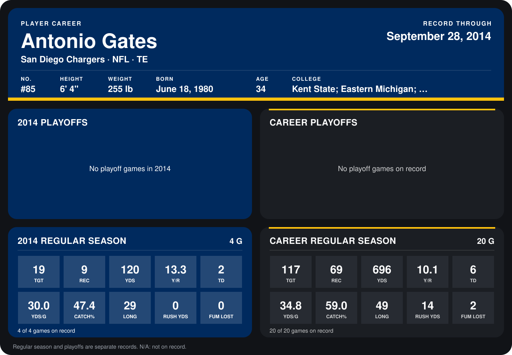

# Antonio Gates

## Career stats

### Regular season

| Season | Club | G | TGT | REC | YDS | Y/R | TD | YDS/G | CATCH% | LONG | RUSH YDS | FUM LOST |
|---|---|---:|---:|---:|---:|---:|---:|---:|---:|---:|---:|---:|
| 2013 | San Diego Chargers | 16 | 98 | 60 | 576 | 9.6 | 4 | 36.0 | 61.2 | 49 | 14 | 2 |
| 2014 | San Diego Chargers | 4 | 19 | 9 | 120 | 13.3 | 2 | 30.0 | 47.4 | 29 | 0 | 0 |
| **Career** |  | 20 | 117 | 69 | 696 | 10.1 | 6 | 34.8 | 59.0 | 49 | 14 | 2 |

### Playoffs

No playoff games on record.

## Awards

None on record.

Schools listed: Kent State; Eastern Michigan; Michigan State; College of the Sequoias.

Records through September 28, 2014. Identity: listed 2014 roster data, Weeks 1-4; number: 2014 Week 1 roster. [All San Diego Chargers players](README.md).
