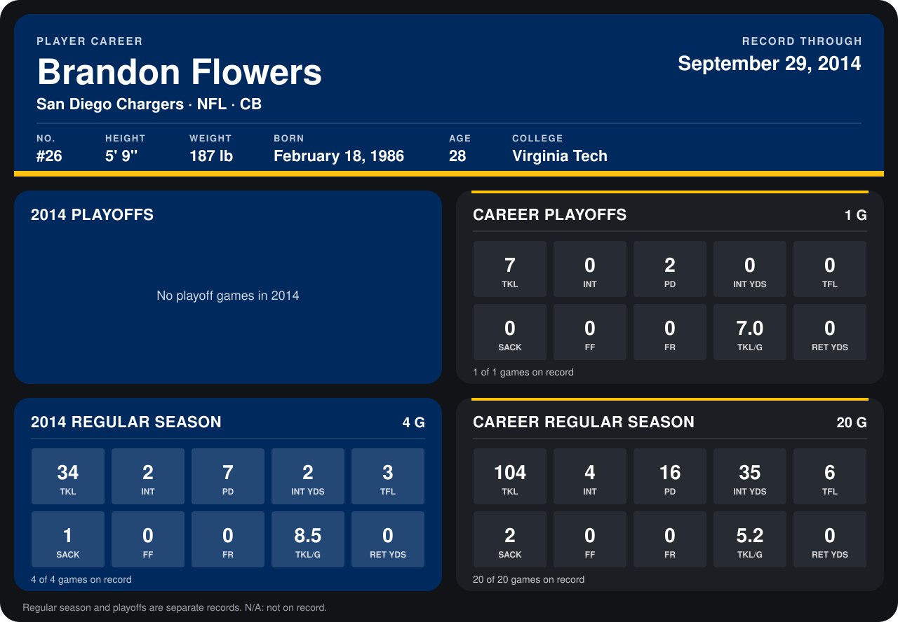

# Brandon Flowers

## Career stats

### Regular season

| Season | Club | G | TKL | INT | PD | INT YDS | TFL | SACK | FF | FR | TKL/G | RET YDS |
|---|---|---:|---:|---:|---:|---:|---:|---:|---:|---:|---:|---:|
| 2013 | Kansas City Chiefs | 16 | 70 | 2 | 9 | 33 | 3 | 1 | 0 | 0 | 4.4 | 0 |
| 2014 | San Diego Chargers | 4 | 34 | 2 | 7 | 2 | 3 | 1 | 0 | 0 | 8.5 | 0 |
| **Career** |  | 20 | 104 | 4 | 16 | 35 | 6 | 2 | 0 | 0 | 5.2 | 0 |

### Playoffs

| Season | Club | G | TKL | INT | PD | INT YDS | TFL | SACK | FF | FR | TKL/G | RET YDS |
|---|---|---:|---:|---:|---:|---:|---:|---:|---:|---:|---:|---:|
| 2013 | Kansas City Chiefs | 1 | 7 | 0 | 2 | 0 | 0 | 0 | 0 | 0 | 7.0 | 0 |
| **Career** |  | 1 | 7 | 0 | 2 | 0 | 0 | 0 | 0 | 0 | 7.0 | 0 |

## Awards

None on record.

Records through September 29, 2014. Identity: listed 2014 roster data, Weeks 1-4; number: 2014 Week 1 roster. [All San Diego Chargers players](README.md).
