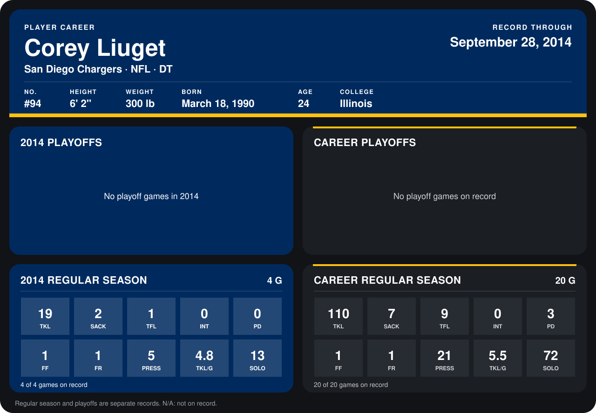

# Corey Liuget

## Career stats

### Regular season

| Season | Club | G | TKL | SACK | TFL | INT | PD | FF | FR | PRESS | TKL/G | SOLO |
|---|---|---:|---:|---:|---:|---:|---:|---:|---:|---:|---:|---:|
| 2013 | San Diego Chargers | 16 | 91 | 5 | 8 | 0 | 3 | 0 | 0 | 16 | 5.7 | 59 |
| 2014 | San Diego Chargers | 4 | 19 | 2 | 1 | 0 | 0 | 1 | 1 | 5 | 4.8 | 13 |
| **Career** |  | 20 | 110 | 7 | 9 | 0 | 3 | 1 | 1 | 21 | 5.5 | 72 |

### Playoffs

No playoff games on record.

## Awards

None on record.

Records through September 28, 2014. Identity: listed 2014 roster data, Weeks 1-4; number: 2014 Week 1 roster. [All San Diego Chargers players](README.md).
