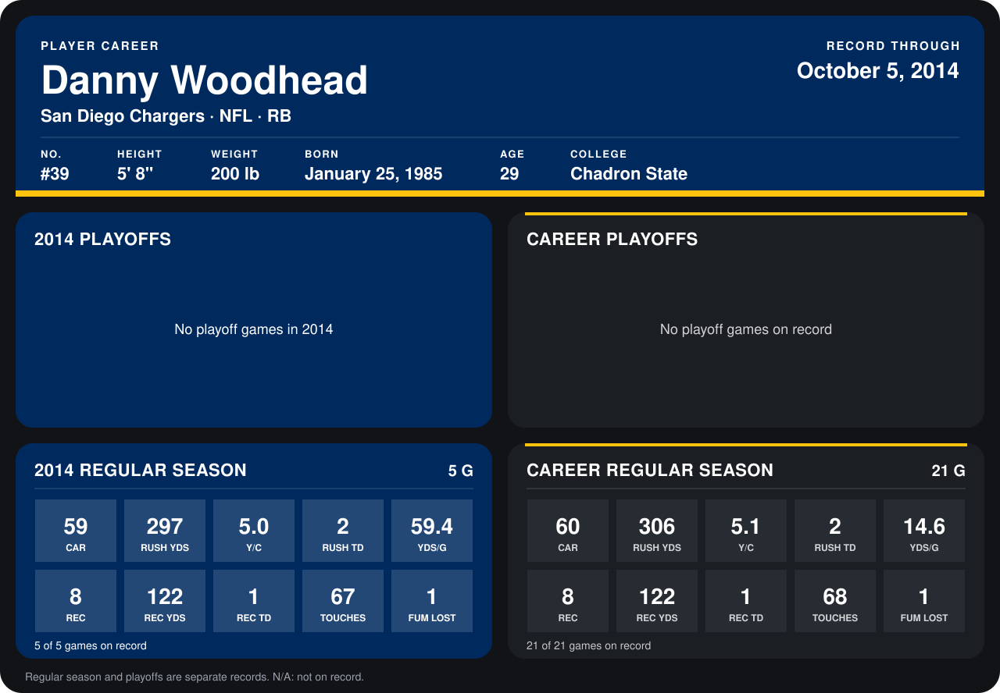

# Danny Woodhead

## Career stats

### Regular season

| Season | Team | Age | # | G | CAR | RUSH YDS | Y/C | RUSH TD | YDS/G | REC | REC YDS | REC TD | TOUCHES | FUM LOST |
|---|---|---:|---:|---:|---:|---:|---:|---:|---:|---:|---:|---:|---:|---:|
| 2013 | San Diego Chargers | 28 | 39 | 16 | 1 | 9 | 9.0 | 0 | 0.6 | 0 | 0 | 0 | 1 | 0 |
| 2014 | San Diego Chargers | 29 | 39 | 4 | 36 | 185 | 5.1 | 1 | 46.2 | 4 | 65 | 0 | 40 | 1 |
| **Career** |  |  |  | 20 | 37 | 194 | 5.2 | 1 | 9.7 | 4 | 65 | 0 | 41 | 1 |

### Playoffs

No playoff games on record.

## Awards

None on record.

Age is his age on the league's opening game of each season; # is the number listed for him that season with that team (2014: the card's rule; 2013: the 2013 season roster), N/A where no listing applies.

Records through September 28, 2014. Identity: listed 2014 roster data, Weeks 1-4; number: 2014 Week 1 roster. [All San Diego Chargers players](README.md).
