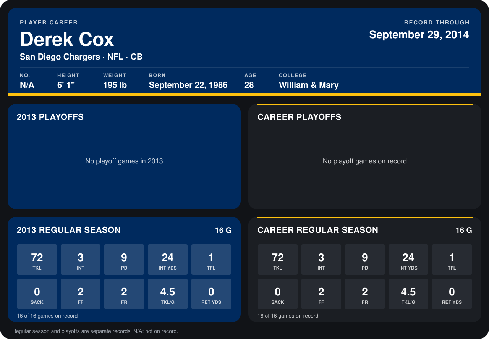

# Derek Cox

## Career stats

### Regular season

| Season | Club | G | TKL | INT | PD | INT YDS | TFL | SACK | FF | FR | TKL/G | RET YDS |
|---|---|---:|---:|---:|---:|---:|---:|---:|---:|---:|---:|---:|
| 2013 | San Diego Chargers | 16 | 72 | 3 | 9 | 24 | 1 | 0 | 2 | 2 | 4.5 | 0 |
| **Career** |  | 16 | 72 | 3 | 9 | 24 | 1 | 0 | 2 | 2 | 4.5 | 0 |

### Playoffs

No playoff games on record.

## Awards

None on record.

Records through September 29, 2014. Identity: the public player file's latest listing (no 2014 Weeks 1-4 roster row). [All San Diego Chargers players](README.md).
