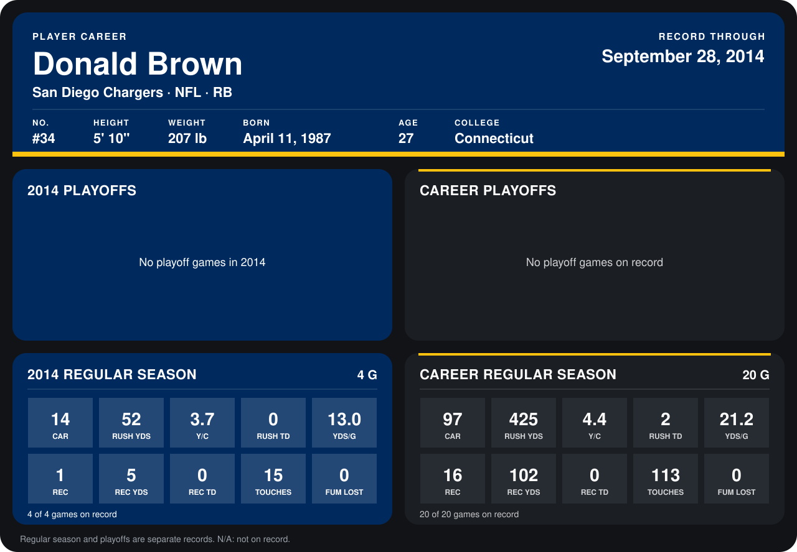

# Donald Brown

## Career stats

### Regular season

| Season | Club | G | CAR | RUSH YDS | Y/C | RUSH TD | YDS/G | REC | REC YDS | REC TD | TOUCHES | FUM LOST |
|---|---|---:|---:|---:|---:|---:|---:|---:|---:|---:|---:|---:|
| 2013 | Indianapolis Colts | 16 | 83 | 373 | 4.5 | 2 | 23.3 | 15 | 97 | 0 | 98 | 0 |
| 2014 | San Diego Chargers | 4 | 14 | 52 | 3.7 | 0 | 13.0 | 1 | 5 | 0 | 15 | 0 |
| **Career** |  | 20 | 97 | 425 | 4.4 | 2 | 21.2 | 16 | 102 | 0 | 113 | 0 |

### Playoffs

No playoff games on record.

## Awards

None on record.

Records through September 29, 2014. Identity: listed 2014 roster data, Weeks 1-4; number: 2014 Week 1 roster. [All San Diego Chargers players](README.md).
