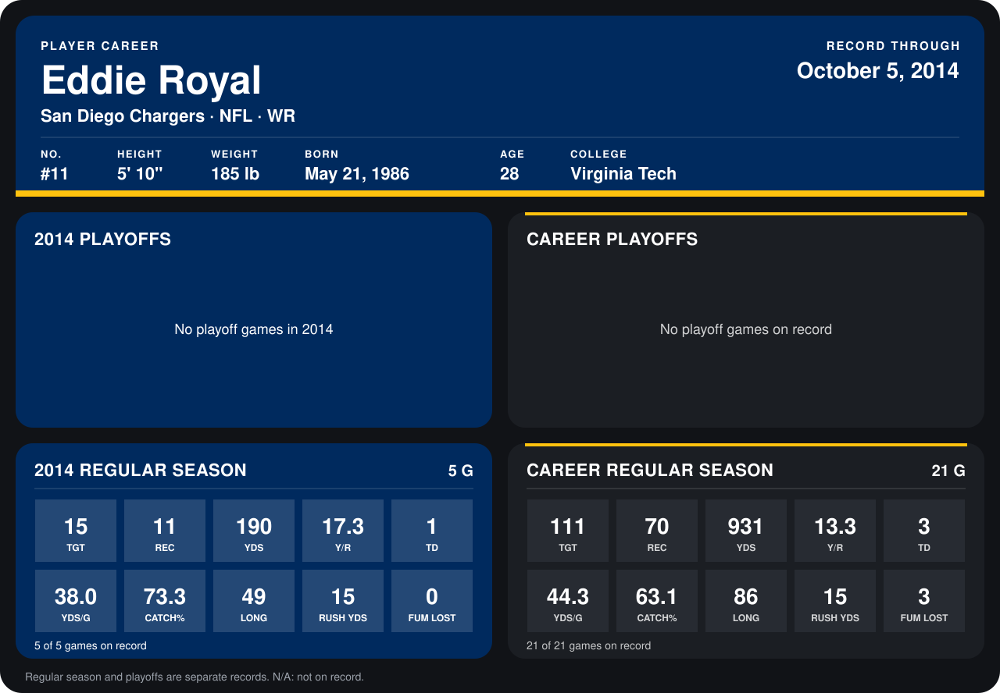

# Eddie Royal

## Career stats

### Regular season

| Season | Team | Age | # | G | TGT | REC | YDS | Y/R | TD | YDS/G | CATCH% | LONG | RUSH YDS | FUM LOST |
|---|---|---:|---:|---:|---:|---:|---:|---:|---:|---:|---:|---:|---:|---:|
| 2013 | San Diego Chargers | 27 | 11 | 16 | 96 | 59 | 741 | 12.6 | 2 | 46.3 | 61.5 | 86 | 0 | 3 |
| 2014 | San Diego Chargers | 28 | 11 | 4 | 10 | 8 | 164 | 20.5 | 1 | 41.0 | 80.0 | 49 | 15 | 0 |
| **Career** |  |  |  | 20 | 106 | 67 | 905 | 13.5 | 3 | 45.2 | 63.2 | 86 | 15 | 3 |

### Playoffs

No playoff games on record.

## Awards

- Pro Bowl selection (2013, RS)

Age is his age on the league's opening game of each season; # is the number listed for him that season with that team (2014: the card's rule; 2013: the 2013 season roster), N/A where no listing applies.

Records through September 28, 2014. Identity: listed 2014 roster data, Weeks 1-4; number: 2014 Week 1 roster. [All San Diego Chargers players](README.md).
