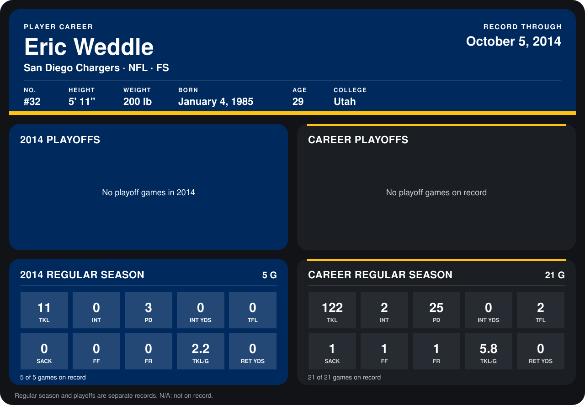

# Eric Weddle

## Career stats

### Regular season

| Season | Club | G | TKL | INT | PD | INT YDS | TFL | SACK | FF | FR | TKL/G | RET YDS |
|---|---|---:|---:|---:|---:|---:|---:|---:|---:|---:|---:|---:|
| 2013 | San Diego Chargers | 16 | 111 | 2 | 22 | 0 | 2 | 1 | 1 | 1 | 6.9 | 0 |
| 2014 | San Diego Chargers | 4 | 9 | 0 | 3 | 0 | 0 | 0 | 0 | 0 | 2.2 | 0 |
| **Career** |  | 20 | 120 | 2 | 25 | 0 | 2 | 1 | 1 | 1 | 6.0 | 0 |

### Playoffs

No playoff games on record.

## Awards

- AFC Defensive Player of the Week (2013, Week 16)

Records through September 28, 2014. Identity: listed 2014 roster data, Weeks 1-4; number: 2014 Week 1 roster. [All San Diego Chargers players](README.md).
