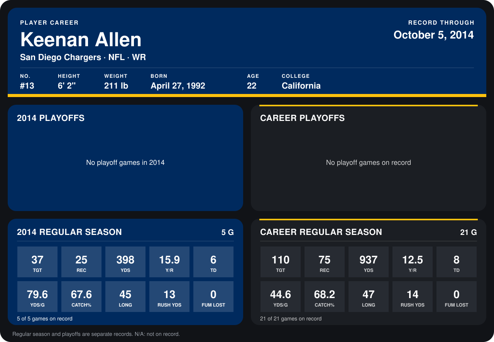

# Keenan Allen

## Career stats

### Regular season

| Season | Club | G | TGT | REC | YDS | Y/R | TD | YDS/G | CATCH% | LONG | RUSH YDS | FUM LOST |
|---|---|---:|---:|---:|---:|---:|---:|---:|---:|---:|---:|---:|
| 2013 | San Diego Chargers | 16 | 73 | 50 | 539 | 10.8 | 2 | 33.7 | 68.5 | 47 | 1 | 0 |
| 2014 | San Diego Chargers | 5 | 37 | 25 | 398 | 15.9 | 6 | 79.6 | 67.6 | 45 | 13 | 0 |
| **Career** |  | 21 | 110 | 75 | 937 | 12.5 | 8 | 44.6 | 68.2 | 47 | 14 | 0 |

### Playoffs

No playoff games on record.

## Awards

None on record.

Records through October 5, 2014. Identity: listed 2014 roster data, Weeks 1-4; number: 2014 Week 1 roster. [All San Diego Chargers players](README.md).
