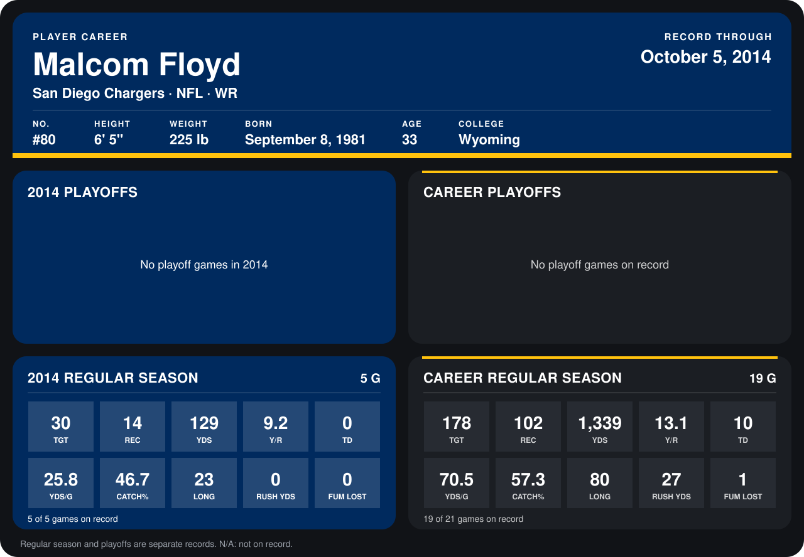

# Malcom Floyd

## Career stats

### Regular season

| Season | Team | Age | # | G | TGT | REC | YDS | Y/R | TD | YDS/G | CATCH% | LONG | RUSH YDS | FUM LOST |
|---|---|---:|---:|---:|---:|---:|---:|---:|---:|---:|---:|---:|---:|---:|
| 2013 | San Diego Chargers | 31 | 80 | 14 | 148 | 88 | 1,210 | 13.8 | 10 | 86.4 | 59.5 | 80 | 27 | 1 |
| 2014 | San Diego Chargers | 32 | 80 | 5 | 30 | 14 | 129 | 9.2 | 0 | 25.8 | 46.7 | 23 | 0 | 0 |
| **Career** |  |  |  | 19 | 178 | 102 | 1,339 | 13.1 | 10 | 70.5 | 57.3 | 80 | 27 | 1 |

### Playoffs

No playoff games on record.

## Awards

- AP Second-Team All-Pro (2013, WR)
- Pro Bowl selection (2013, WR)

Age is his age on the league's opening game of each season; # is the number listed for him that season with that team (2014: the card's rule; 2013: the 2013 season roster), N/A where no listing applies.

Records through October 5, 2014. Identity: listed 2014 roster data, Weeks 1-4; number: 2014 Week 1 roster. [All San Diego Chargers players](README.md).
