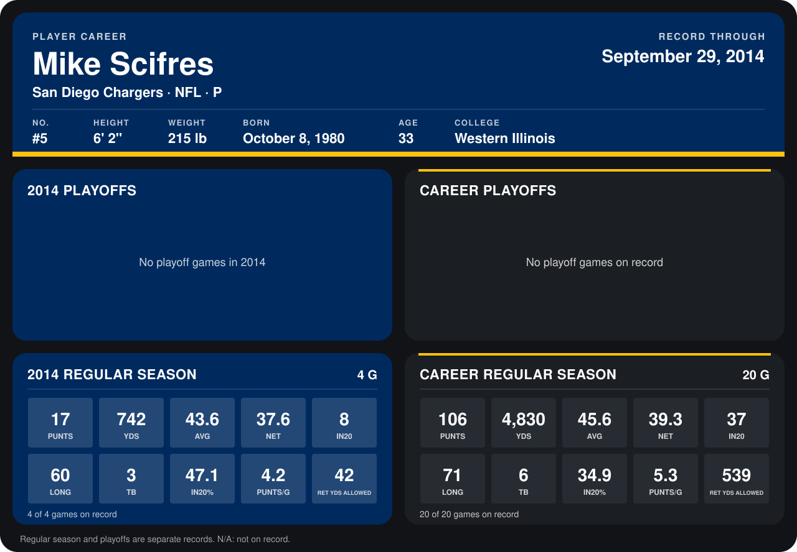

# Mike Scifres

## Career stats

### Regular season

| Season | Club | G | PUNTS | YDS | AVG | NET | IN20 | LONG | TB | IN20% | PUNTS/G | RET YDS ALLOWED |
|---|---|---:|---:|---:|---:|---:|---:|---:|---:|---:|---:|---:|
| 2013 | San Diego Chargers | 16 | 89 | 4,088 | 45.9 | 39.7 | 29 | 71 | 3 | 32.6 | 5.6 | 497 |
| 2014 | San Diego Chargers | 4 | 17 | 742 | 43.6 | 37.6 | 8 | 60 | 3 | 47.1 | 4.2 | 42 |
| **Career** |  | 20 | 106 | 4,830 | 45.6 | 39.3 | 37 | 71 | 6 | 34.9 | 5.3 | 539 |

### Playoffs

No playoff games on record.

## Awards

- AFC Special Teams Player of the Week (2013, Week 13)

Records through September 28, 2014. Identity: listed 2014 roster data, Weeks 1-4; number: 2014 Week 1 roster. [All San Diego Chargers players](README.md).
