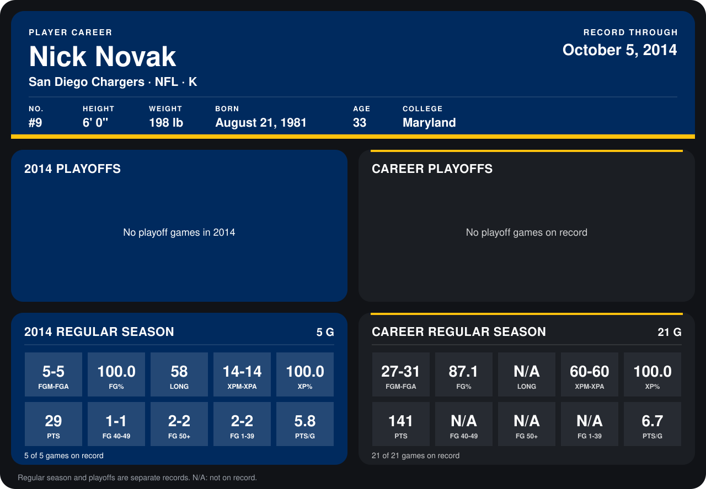

# Nick Novak

## Career stats

### Regular season

| Season | Team | Age | # | G | FGM-FGA | FG% | LONG | XPM-XPA | XP% | PTS | FG 40-49 | FG 50+ | FG 1-39 | PTS/G |
|---|---|---:|---:|---:|---:|---:|---:|---:|---:|---:|---:|---:|---:|---:|
| 2013 | San Diego Chargers | 32 | 9 | 16 | 22-26 | 84.6 | N/A | 46-46 | 100.0 | 112 | N/A | N/A | N/A | 7.0 |
| 2014 | San Diego Chargers | 33 | 9 | 4 | 3-3 | 100.0 | 58 | 11-11 | 100.0 | 20 | 0-0 | 1-1 | 2-2 | 5.0 |
| **Career** |  |  |  | 20 | 25-29 | 86.2 | N/A | 57-57 | 100.0 | 132 | N/A | N/A | N/A | 6.6 |

### Playoffs

No playoff games on record.

## Awards

None on record.

Age is his age on the league's opening game of each season; # is the number listed for him that season with that team (2014: the card's rule; 2013: the 2013 season roster), N/A where no listing applies.

Records through September 28, 2014. Identity: listed 2014 roster data, Weeks 1-4; number: 2014 Week 1 roster. [All San Diego Chargers players](README.md).
