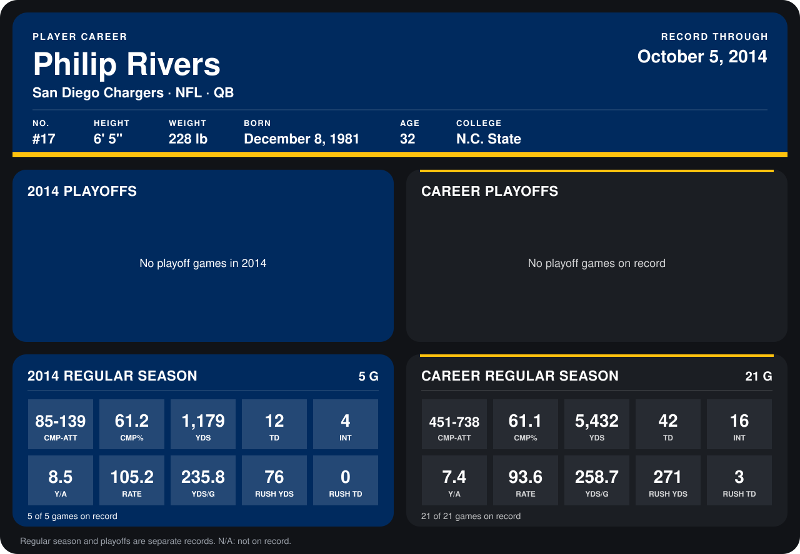

# Philip Rivers

## Career stats

### Regular season

| Season | Club | G | CMP-ATT | CMP% | YDS | TD | INT | Y/A | RATE | YDS/G | RUSH YDS | RUSH TD |
|---|---|---:|---:|---:|---:|---:|---:|---:|---:|---:|---:|---:|
| 2013 | San Diego Chargers | 16 | 366-599 | 61.1 | 4,253 | 30 | 12 | 7.1 | 90.9 | 265.8 | 195 | 3 |
| 2014 | San Diego Chargers | 4 | 69-115 | 60.0 | 1,002 | 9 | 4 | 8.7 | 100.0 | 250.5 | 62 | 0 |
| **Career** |  | 20 | 435-714 | 60.9 | 5,255 | 39 | 16 | 7.4 | 92.4 | 262.8 | 257 | 3 |

### Playoffs

No playoff games on record.

## Awards

- AFC Offensive Player of the Month (2013, September)
- AFC Offensive Player of the Week (2013, Week 12)
- AP First-Team All-Pro (2013, QB)
- Pro Bowl selection (2013, QB)

Records through September 28, 2014. Identity: listed 2014 roster data, Weeks 1-4; number: 2014 Week 1 roster. [All San Diego Chargers players](README.md).
