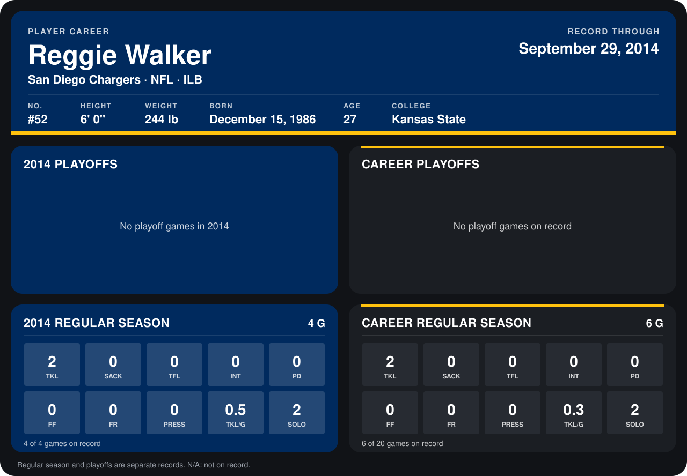

# Reggie Walker

## Career stats

### Regular season

| Season | Club | G | TKL | SACK | TFL | INT | PD | FF | FR | PRESS | TKL/G | SOLO |
|---|---|---:|---:|---:|---:|---:|---:|---:|---:|---:|---:|---:|
| 2013 | San Diego Chargers | 2 | 0 | 0 | 0 | 0 | 0 | 0 | 0 | 0 | 0.0 | 0 |
| 2014 | San Diego Chargers | 4 | 2 | 0 | 0 | 0 | 0 | 0 | 0 | 0 | 0.5 | 2 |
| **Career** |  | 6 | 2 | 0 | 0 | 0 | 0 | 0 | 0 | 0 | 0.3 | 2 |

### Playoffs

No playoff games on record.

## Awards

None on record.

Records through September 28, 2014. Identity: listed 2014 roster data, Weeks 1-4; number: 2014 Week 1 roster. [All San Diego Chargers players](README.md).
