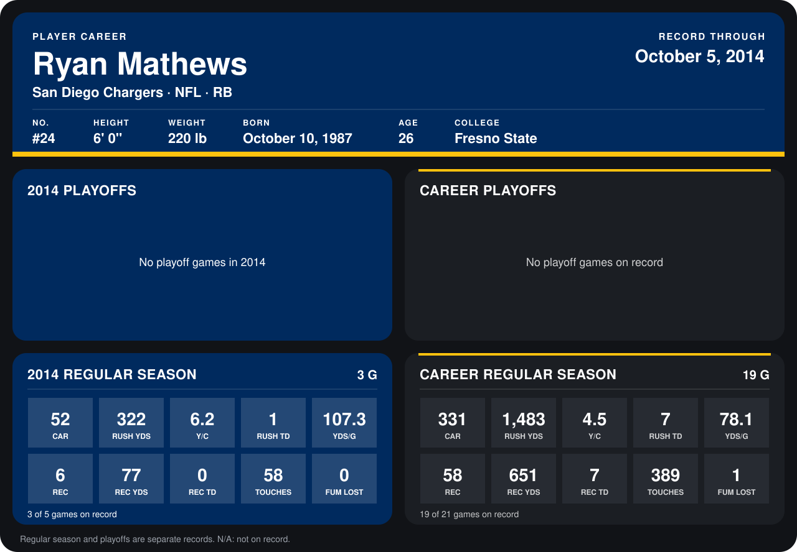

# Ryan Mathews

## Career stats

### Regular season

| Season | Club | G | CAR | RUSH YDS | Y/C | RUSH TD | YDS/G | REC | REC YDS | REC TD | TOUCHES | FUM LOST |
|---|---|---:|---:|---:|---:|---:|---:|---:|---:|---:|---:|---:|
| 2013 | San Diego Chargers | 16 | 279 | 1,161 | 4.2 | 6 | 72.6 | 52 | 574 | 7 | 331 | 1 |
| 2014 | San Diego Chargers | 3 | 52 | 322 | 6.2 | 1 | 107.3 | 6 | 77 | 0 | 58 | 0 |
| **Career** |  | 19 | 331 | 1,483 | 4.5 | 7 | 78.1 | 58 | 651 | 7 | 389 | 1 |

### Playoffs

No playoff games on record.

## Awards

- AFC Offensive Player of the Week (2013, Week 10)

Records through September 28, 2014. Identity: listed 2014 roster data, Weeks 1-4; number: 2014 Week 1 roster. [All San Diego Chargers players](README.md).
