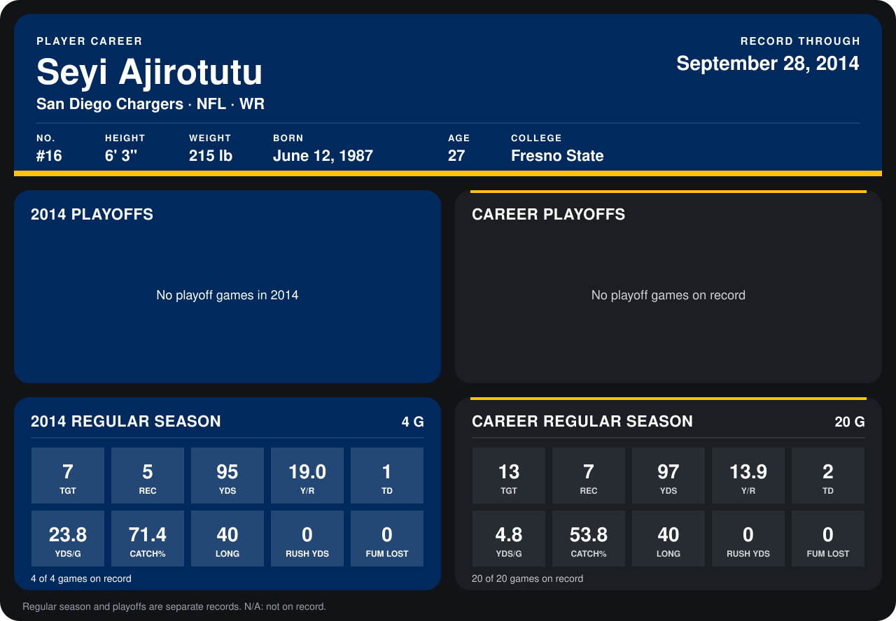

# Seyi Ajirotutu

## Career stats

### Regular season

| Season | Club | G | TGT | REC | YDS | Y/R | TD | YDS/G | CATCH% | LONG | RUSH YDS | FUM LOST |
|---|---|---:|---:|---:|---:|---:|---:|---:|---:|---:|---:|---:|
| 2013 | San Diego Chargers | 16 | 6 | 2 | 2 | 1.0 | 1 | 0.1 | 33.3 | 3 | 0 | 0 |
| 2014 | San Diego Chargers | 4 | 7 | 5 | 95 | 19.0 | 1 | 23.8 | 71.4 | 40 | 0 | 0 |
| **Career** |  | 20 | 13 | 7 | 97 | 13.9 | 2 | 4.8 | 53.8 | 40 | 0 | 0 |

### Playoffs

No playoff games on record.

## Awards

None on record.

Records through September 29, 2014. Identity: listed 2014 roster data, Weeks 1-4; number: 2014 Week 1 roster. [All San Diego Chargers players](README.md).
