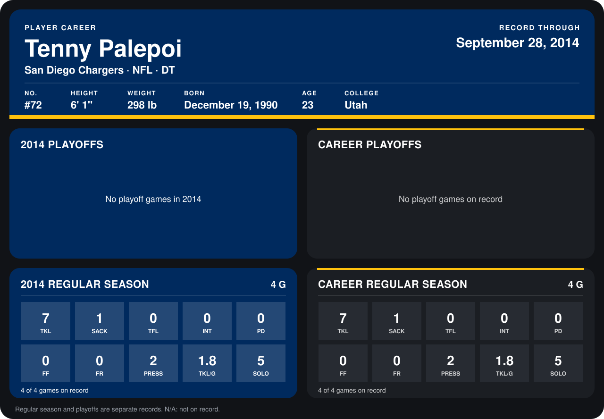

# Tenny Palepoi

## Career stats

### Regular season

| Season | Club | G | TKL | SACK | TFL | INT | PD | FF | FR | PRESS | TKL/G | SOLO |
|---|---|---:|---:|---:|---:|---:|---:|---:|---:|---:|---:|---:|
| 2014 | San Diego Chargers | 5 | 11 | 3 | 0 | 0 | 0 | 1 | 0 | 4 | 2.2 | 8 |
| **Career** |  | 5 | 11 | 3 | 0 | 0 | 0 | 1 | 0 | 4 | 2.2 | 8 |

### Playoffs

No playoff games on record.

## Awards

None on record.

Records through October 5, 2014. Identity: listed 2014 roster data, Weeks 1-4; number: 2014 Week 1 roster. [All San Diego Chargers players](README.md).
