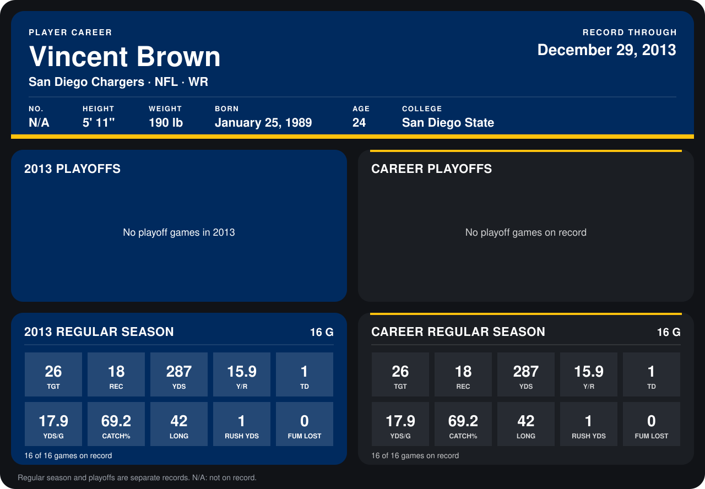

# Vincent Brown

## Career stats

### Regular season

| Season | Club | G | TGT | REC | YDS | Y/R | TD | YDS/G | CATCH% | LONG | RUSH YDS | FUM LOST |
|---|---|---:|---:|---:|---:|---:|---:|---:|---:|---:|---:|---:|
| 2013 | San Diego Chargers | 16 | 26 | 18 | 287 | 15.9 | 1 | 17.9 | 69.2 | 42 | 1 | 0 |
| **Career** |  | 16 | 26 | 18 | 287 | 15.9 | 1 | 17.9 | 69.2 | 42 | 1 | 0 |

### Playoffs

No playoff games on record.

## Awards

None on record.

Records through September 29, 2014. Identity: listed 2014 roster data, Weeks 1-4. [All San Diego Chargers players](README.md).
