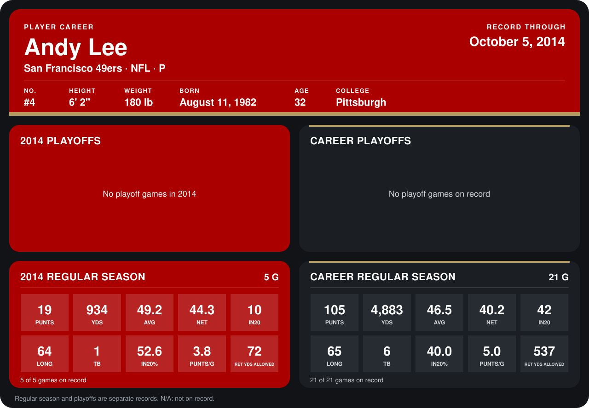

# Andy Lee

## Career stats

### Regular season

| Season | Team | Age | # | G | PUNTS | YDS | AVG | NET | IN20 | LONG | TB | IN20% | PUNTS/G | RET YDS ALLOWED |
|---|---|---:|---:|---:|---:|---:|---:|---:|---:|---:|---:|---:|---:|---:|
| 2013 | San Francisco 49ers | 31 | 4 | 16 | 86 | 3,949 | 45.9 | 39.3 | 32 | 65 | 5 | 37.2 | 5.4 | 465 |
| 2014 | San Francisco 49ers | 32 | 4 | 4 | 14 | 687 | 49.1 | 43.8 | 9 | 64 | 1 | 64.3 | 3.5 | 54 |
| **Career** |  |  |  | 20 | 100 | 4,636 | 46.4 | 40.0 | 41 | 65 | 6 | 41.0 | 5.0 | 519 |

### Playoffs

No playoff games on record.

## Awards

- NFC Special Teams Player of the Week (2014, Week 1)

Age is his age on the league's opening game of each season; # is the number listed for him that season with that team (2014: the card's rule; 2013: the 2013 season roster), N/A where no listing applies.

Records through September 28, 2014. Identity: listed 2014 roster data, Weeks 1-4; number: 2014 Week 1 roster. [All San Francisco 49ers players](README.md).
