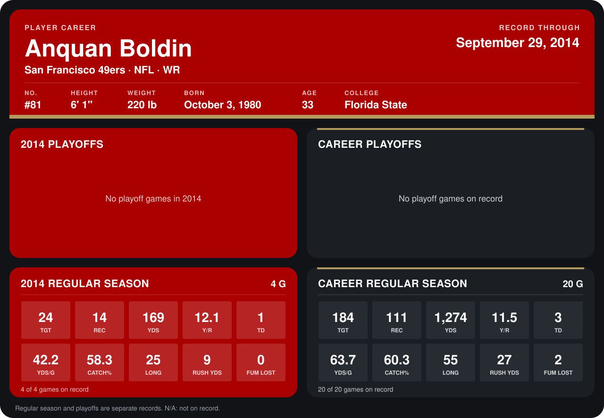

# Anquan Boldin

## Career stats

### Regular season

| Season | Team | Age | # | G | TGT | REC | YDS | Y/R | TD | YDS/G | CATCH% | LONG | RUSH YDS | FUM LOST |
|---|---|---:|---:|---:|---:|---:|---:|---:|---:|---:|---:|---:|---:|---:|
| 2013 | San Francisco 49ers | 32 | 81 | 16 | 160 | 97 | 1,105 | 11.4 | 2 | 69.1 | 60.6 | 55 | 18 | 2 |
| 2014 | San Francisco 49ers | 33 | 81 | 5 | 32 | 17 | 213 | 12.5 | 1 | 42.6 | 53.1 | 25 | 9 | 0 |
| **Career** |  |  |  | 21 | 192 | 114 | 1,318 | 11.6 | 3 | 62.8 | 59.4 | 55 | 27 | 2 |

### Playoffs

No playoff games on record.

## Awards

None on record.

Age is his age on the league's opening game of each season; # is the number listed for him that season with that team (2014: the card's rule; 2013: the 2013 season roster), N/A where no listing applies.

Records through October 5, 2014. Identity: listed 2014 roster data, Weeks 1-4; number: 2014 Week 1 roster. [All San Francisco 49ers players](README.md).
