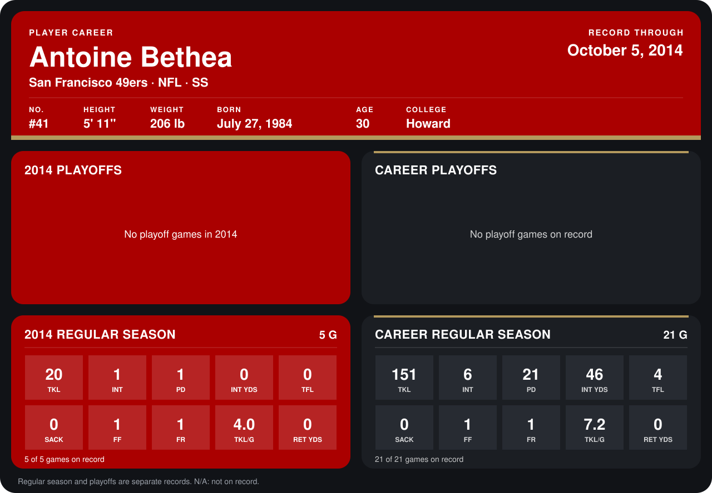

# Antoine Bethea

## Career stats

### Regular season

| Season | Club | G | TKL | INT | PD | INT YDS | TFL | SACK | FF | FR | TKL/G | RET YDS |
|---|---|---:|---:|---:|---:|---:|---:|---:|---:|---:|---:|---:|
| 2013 | Indianapolis Colts | 16 | 131 | 5 | 20 | 46 | 4 | 0 | 0 | 0 | 8.2 | 0 |
| 2014 | San Francisco 49ers | 5 | 20 | 1 | 1 | 0 | 0 | 0 | 1 | 1 | 4.0 | 0 |
| **Career** |  | 21 | 151 | 6 | 21 | 46 | 4 | 0 | 1 | 1 | 7.2 | 0 |

### Playoffs

No playoff games on record.

## Awards

- Pro Bowl selection (2013, S)

Records through October 5, 2014. Identity: listed 2014 roster data, Weeks 1-4; number: 2014 Week 1 roster. [All San Francisco 49ers players](README.md).
