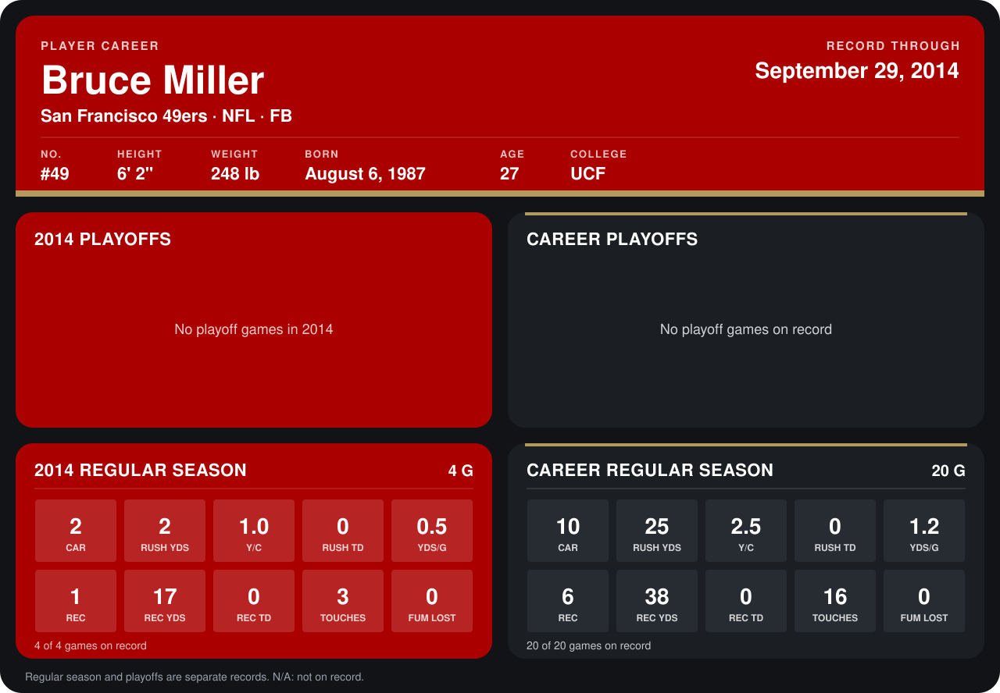

# Bruce Miller

## Career stats

### Regular season

| Season | Club | G | CAR | RUSH YDS | Y/C | RUSH TD | YDS/G | REC | REC YDS | REC TD | TOUCHES | FUM LOST |
|---|---|---:|---:|---:|---:|---:|---:|---:|---:|---:|---:|---:|
| 2013 | San Francisco 49ers | 16 | 8 | 23 | 2.9 | 0 | 1.4 | 5 | 21 | 0 | 13 | 0 |
| 2014 | San Francisco 49ers | 4 | 2 | 2 | 1.0 | 0 | 0.5 | 1 | 17 | 0 | 3 | 0 |
| **Career** |  | 20 | 10 | 25 | 2.5 | 0 | 1.2 | 6 | 38 | 0 | 16 | 0 |

### Playoffs

No playoff games on record.

## Awards

None on record.

Records through September 28, 2014. Identity: listed 2014 roster data, Weeks 1-4; number: 2014 Week 1 roster. [All San Francisco 49ers players](README.md).
