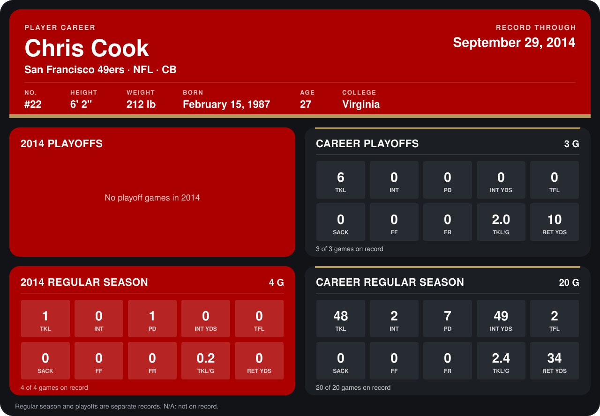

# Chris Cook

## Career stats

### Regular season

| Season | Club | G | TKL | INT | PD | INT YDS | TFL | SACK | FF | FR | TKL/G | RET YDS |
|---|---|---:|---:|---:|---:|---:|---:|---:|---:|---:|---:|---:|
| 2013 | Minnesota Vikings | 16 | 47 | 2 | 6 | 49 | 2 | 0 | 0 | 0 | 2.9 | 34 |
| 2014 | San Francisco 49ers | 5 | 2 | 0 | 1 | 0 | 0 | 0 | 0 | 0 | 0.4 | 0 |
| **Career** |  | 21 | 49 | 2 | 7 | 49 | 2 | 0 | 0 | 0 | 2.3 | 34 |

### Playoffs

| Season | Club | G | TKL | INT | PD | INT YDS | TFL | SACK | FF | FR | TKL/G | RET YDS |
|---|---|---:|---:|---:|---:|---:|---:|---:|---:|---:|---:|---:|
| 2013 | Minnesota Vikings | 3 | 6 | 0 | 0 | 0 | 0 | 0 | 0 | 0 | 2.0 | 10 |
| **Career** |  | 3 | 6 | 0 | 0 | 0 | 0 | 0 | 0 | 0 | 2.0 | 10 |

## Awards

None on record.

Records through October 5, 2014. Identity: listed 2014 roster data, Weeks 1-4; number: 2014 Week 1 roster. [All San Francisco 49ers players](README.md).
