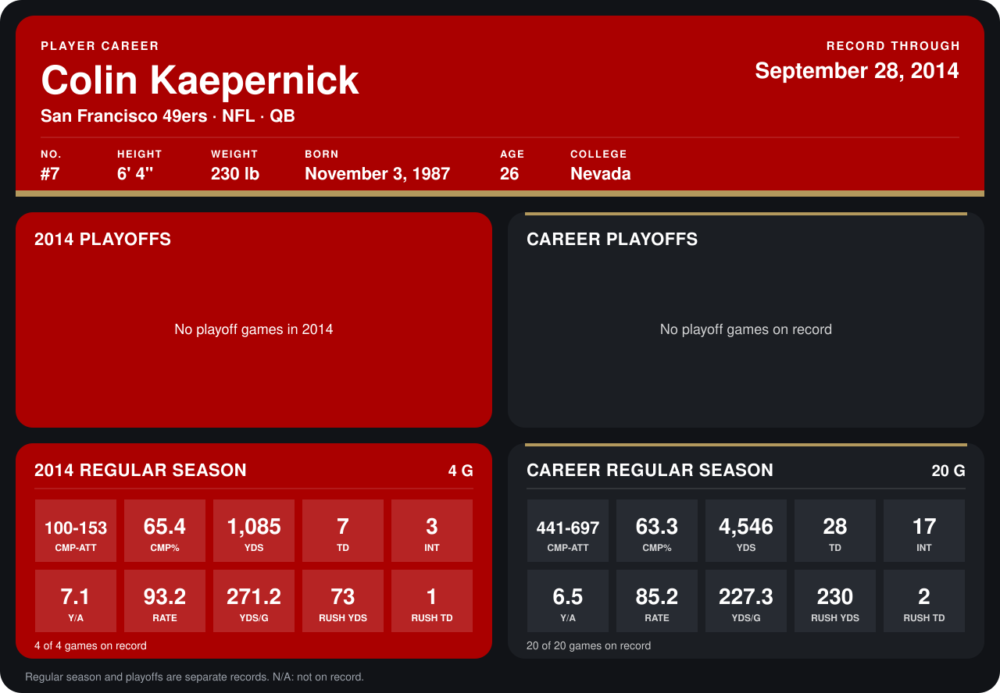

# Colin Kaepernick

## Career stats

### Regular season

| Season | Team | Age | # | G | CMP-ATT | CMP% | YDS | TD | INT | Y/A | RATE | YDS/G | RUSH YDS | RUSH TD |
|---|---|---:|---:|---:|---:|---:|---:|---:|---:|---:|---:|---:|---:|---:|
| 2013 | San Francisco 49ers | 25 | 7 | 16 | 341-544 | 62.7 | 3,461 | 21 | 14 | 6.4 | 83.0 | 216.3 | 157 | 1 |
| 2014 | San Francisco 49ers | 26 | 7 | 4 | 100-153 | 65.4 | 1,085 | 7 | 3 | 7.1 | 93.2 | 271.2 | 73 | 1 |
| **Career** |  |  |  | 20 | 441-697 | 63.3 | 4,546 | 28 | 17 | 6.5 | 85.2 | 227.3 | 230 | 2 |

### Playoffs

No playoff games on record.

## Awards

None on record.

Age is his age on the league's opening game of each season; # is the number listed for him that season with that team (2014: the card's rule; 2013: the 2013 season roster), N/A where no listing applies.

Records through September 28, 2014. Identity: listed 2014 roster data, Weeks 1-4; number: 2014 Week 1 roster. [All San Francisco 49ers players](README.md).
