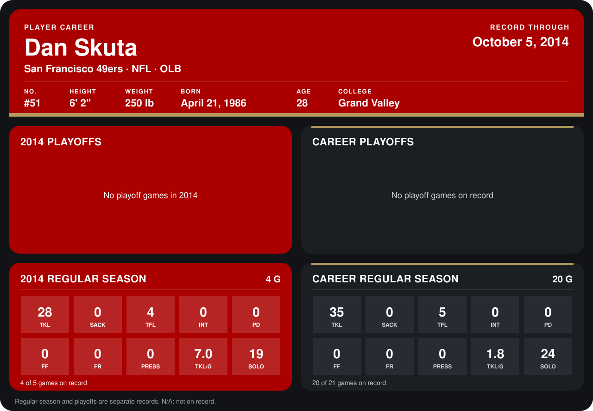

# Dan Skuta

## Career stats

### Regular season

| Season | Club | G | TKL | SACK | TFL | INT | PD | FF | FR | PRESS | TKL/G | SOLO |
|---|---|---:|---:|---:|---:|---:|---:|---:|---:|---:|---:|---:|
| 2013 | San Francisco 49ers | 16 | 7 | 0 | 1 | 0 | 0 | 0 | 0 | 0 | 0.4 | 5 |
| 2014 | San Francisco 49ers | 4 | 28 | 0 | 4 | 0 | 0 | 0 | 0 | 0 | 7.0 | 19 |
| **Career** |  | 20 | 35 | 0 | 5 | 0 | 0 | 0 | 0 | 0 | 1.8 | 24 |

### Playoffs

No playoff games on record.

## Awards

None on record.

Records through October 5, 2014. Identity: listed 2014 roster data, Weeks 1-4; number: 2014 Week 1 roster. [All San Francisco 49ers players](README.md).
