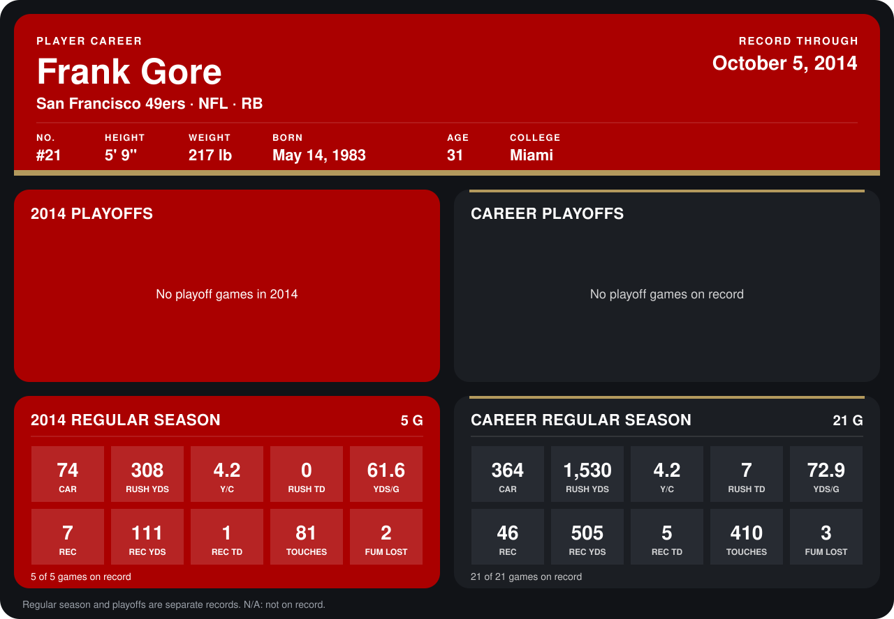

# Frank Gore

## Career stats

### Regular season

| Season | Club | G | CAR | RUSH YDS | Y/C | RUSH TD | YDS/G | REC | REC YDS | REC TD | TOUCHES | FUM LOST |
|---|---|---:|---:|---:|---:|---:|---:|---:|---:|---:|---:|---:|
| 2013 | San Francisco 49ers | 16 | 290 | 1,222 | 4.2 | 7 | 76.4 | 39 | 394 | 4 | 329 | 1 |
| 2014 | San Francisco 49ers | 5 | 74 | 308 | 4.2 | 0 | 61.6 | 7 | 111 | 1 | 81 | 2 |
| **Career** |  | 21 | 364 | 1,530 | 4.2 | 7 | 72.9 | 46 | 505 | 5 | 410 | 3 |

### Playoffs

No playoff games on record.

## Awards

- NFC Offensive Player of the Week (2013, Week 2)

Records through October 5, 2014. Identity: listed 2014 roster data, Weeks 1-4; number: 2014 Week 1 roster. [All San Francisco 49ers players](README.md).
