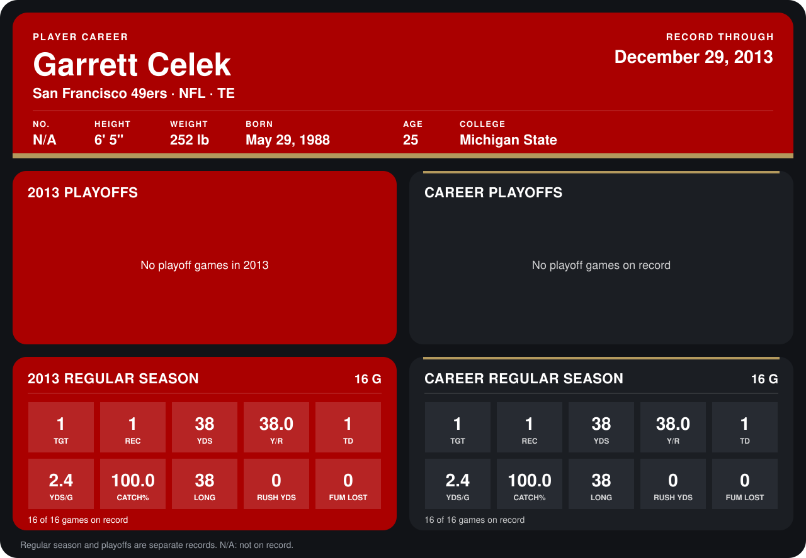

# Garrett Celek

## Career stats

### Regular season

| Season | Club | G | TGT | REC | YDS | Y/R | TD | YDS/G | CATCH% | LONG | RUSH YDS | FUM LOST |
|---|---|---:|---:|---:|---:|---:|---:|---:|---:|---:|---:|---:|
| 2013 | San Francisco 49ers | 16 | 1 | 1 | 38 | 38.0 | 1 | 2.4 | 100.0 | 38 | 0 | 0 |
| **Career** |  | 16 | 1 | 1 | 38 | 38.0 | 1 | 2.4 | 100.0 | 38 | 0 | 0 |

### Playoffs

No playoff games on record.

## Awards

None on record.

Records through September 29, 2014. Identity: the public player file's latest listing (no 2014 Weeks 1-4 roster row). [All San Francisco 49ers players](README.md).
