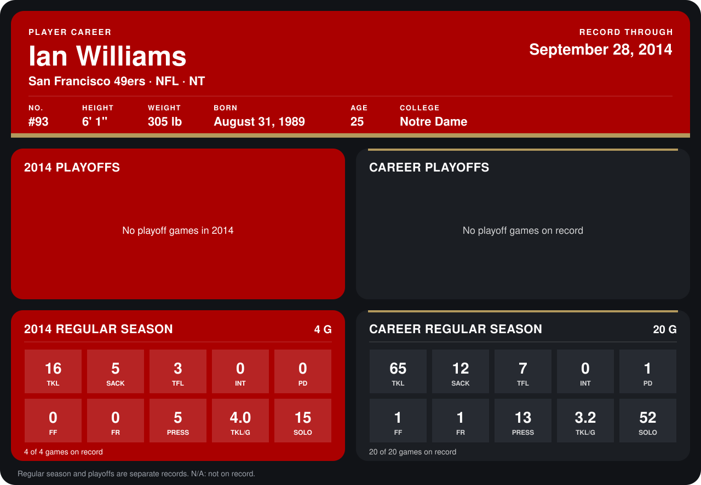

# Ian Williams

## Career stats

### Regular season

| Season | Team | Age | # | G | TKL | SACK | TFL | INT | PD | FF | FR | PRESS | TKL/G | SOLO |
|---|---|---:|---:|---:|---:|---:|---:|---:|---:|---:|---:|---:|---:|---:|
| 2013 | San Francisco 49ers | 24 | 93 | 16 | 49 | 7 | 4 | 0 | 1 | 1 | 1 | 8 | 3.1 | 37 |
| 2014 | San Francisco 49ers | 25 | 93 | 5 | 20 | 6 | 4 | 0 | 0 | 0 | 0 | 6 | 4.0 | 18 |
| **Career** |  |  |  | 21 | 69 | 13 | 8 | 0 | 1 | 1 | 1 | 14 | 3.3 | 55 |

### Playoffs

No playoff games on record.

## Awards

None on record.

Age is his age on the league's opening game of each season; # is the number listed for him that season with that team (2014: the card's rule; 2013: the 2013 season roster), N/A where no listing applies.

Records through October 5, 2014. Identity: listed 2014 roster data, Weeks 1-4; number: 2014 Week 1 roster. [All San Francisco 49ers players](README.md).
