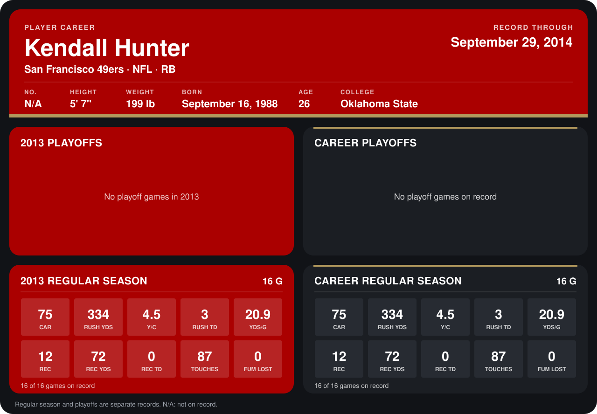

# Kendall Hunter

## Career stats

### Regular season

| Season | Club | G | CAR | RUSH YDS | Y/C | RUSH TD | YDS/G | REC | REC YDS | REC TD | TOUCHES | FUM LOST |
|---|---|---:|---:|---:|---:|---:|---:|---:|---:|---:|---:|---:|
| 2013 | San Francisco 49ers | 16 | 75 | 334 | 4.5 | 3 | 20.9 | 12 | 72 | 0 | 87 | 0 |
| **Career** |  | 16 | 75 | 334 | 4.5 | 3 | 20.9 | 12 | 72 | 0 | 87 | 0 |

### Playoffs

No playoff games on record.

## Awards

None on record.

Records through December 29, 2013. Identity: his listed 2013 season roster data (no 2014 Weeks 1-4 roster row). [All San Francisco 49ers players](README.md).
