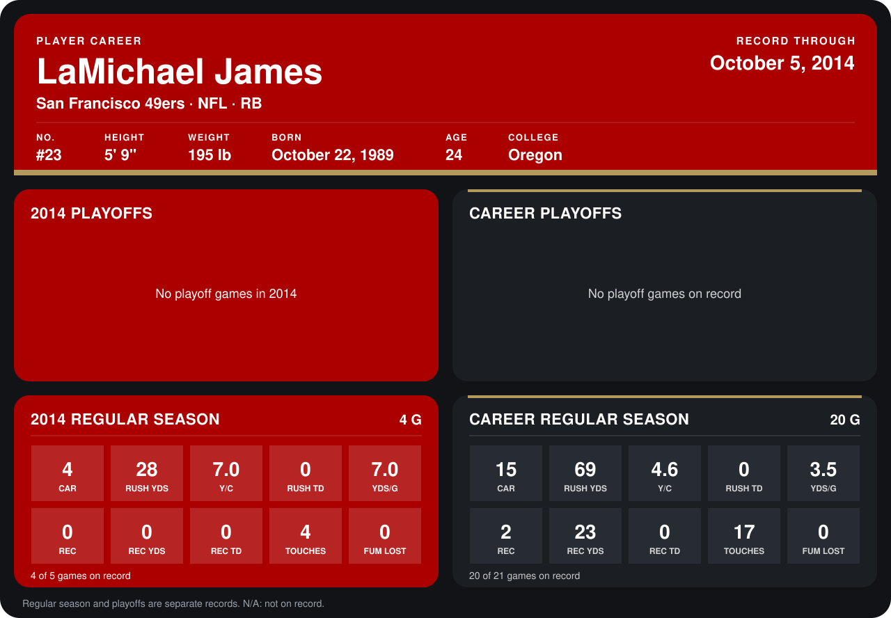

# LaMichael James

## Career stats

### Regular season

| Season | Club | G | CAR | RUSH YDS | Y/C | RUSH TD | YDS/G | REC | REC YDS | REC TD | TOUCHES | FUM LOST |
|---|---|---:|---:|---:|---:|---:|---:|---:|---:|---:|---:|---:|
| 2013 | San Francisco 49ers | 16 | 11 | 41 | 3.7 | 0 | 2.6 | 2 | 23 | 0 | 13 | 0 |
| 2014 | San Francisco 49ers | 4 | 4 | 28 | 7.0 | 0 | 7.0 | 0 | 0 | 0 | 4 | 0 |
| **Career** |  | 20 | 15 | 69 | 4.6 | 0 | 3.5 | 2 | 23 | 0 | 17 | 0 |

### Playoffs

No playoff games on record.

## Awards

- NFC Special Teams Player of the Month (2013, September)

Records through September 29, 2014. Identity: listed 2014 roster data, Weeks 1-4; number: 2014 Week 1 roster. [All San Francisco 49ers players](README.md).
