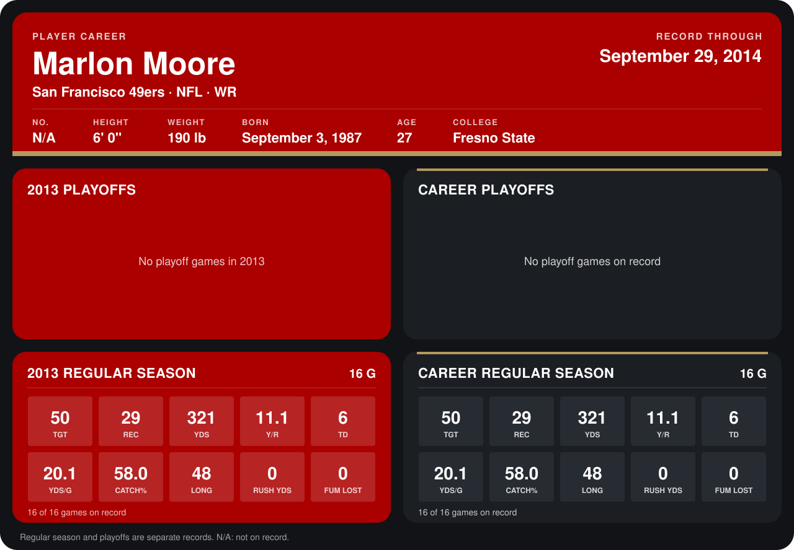

# Marlon Moore

## Career stats

### Regular season

| Season | Club | G | TGT | REC | YDS | Y/R | TD | YDS/G | CATCH% | LONG | RUSH YDS | FUM LOST |
|---|---|---:|---:|---:|---:|---:|---:|---:|---:|---:|---:|---:|
| 2013 | San Francisco 49ers | 16 | 50 | 29 | 321 | 11.1 | 6 | 20.1 | 58.0 | 48 | 0 | 0 |
| **Career** |  | 16 | 50 | 29 | 321 | 11.1 | 6 | 20.1 | 58.0 | 48 | 0 | 0 |

### Playoffs

No playoff games on record.

## Awards

None on record.

Records through December 29, 2013. Identity: listed 2014 roster data, Weeks 1-4. [All San Francisco 49ers players](README.md).
