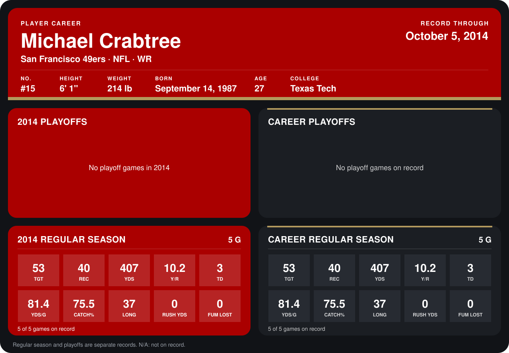

# Michael Crabtree

## Career stats

### Regular season

| Season | Club | G | TGT | REC | YDS | Y/R | TD | YDS/G | CATCH% | LONG | RUSH YDS | FUM LOST |
|---|---|---:|---:|---:|---:|---:|---:|---:|---:|---:|---:|---:|
| 2014 | San Francisco 49ers | 4 | 47 | 37 | 364 | 9.8 | 3 | 91.0 | 78.7 | 37 | 0 | 0 |
| **Career** |  | 4 | 47 | 37 | 364 | 9.8 | 3 | 91.0 | 78.7 | 37 | 0 | 0 |

### Playoffs

No playoff games on record.

## Awards

None on record.

Records through September 28, 2014. Identity: listed 2014 roster data, Weeks 1-4; number: 2014 Week 1 roster. [All San Francisco 49ers players](README.md).
