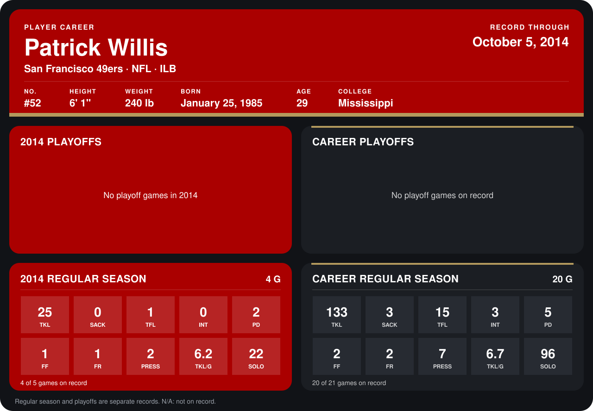

# Patrick Willis

## Career stats

### Regular season

| Season | Club | G | TKL | SACK | TFL | INT | PD | FF | FR | PRESS | TKL/G | SOLO |
|---|---|---:|---:|---:|---:|---:|---:|---:|---:|---:|---:|---:|
| 2013 | San Francisco 49ers | 16 | 108 | 3 | 14 | 3 | 3 | 1 | 1 | 5 | 6.8 | 74 |
| 2014 | San Francisco 49ers | 4 | 25 | 0 | 1 | 0 | 2 | 1 | 1 | 2 | 6.2 | 22 |
| **Career** |  | 20 | 133 | 3 | 15 | 3 | 5 | 2 | 2 | 7 | 6.7 | 96 |

### Playoffs

No playoff games on record.

## Awards

- NFC Defensive Player of the Week (2013, Week 2)

Records through October 5, 2014. Identity: listed 2014 roster data, Weeks 1-4; number: 2014 Week 1 roster. [All San Francisco 49ers players](README.md).
