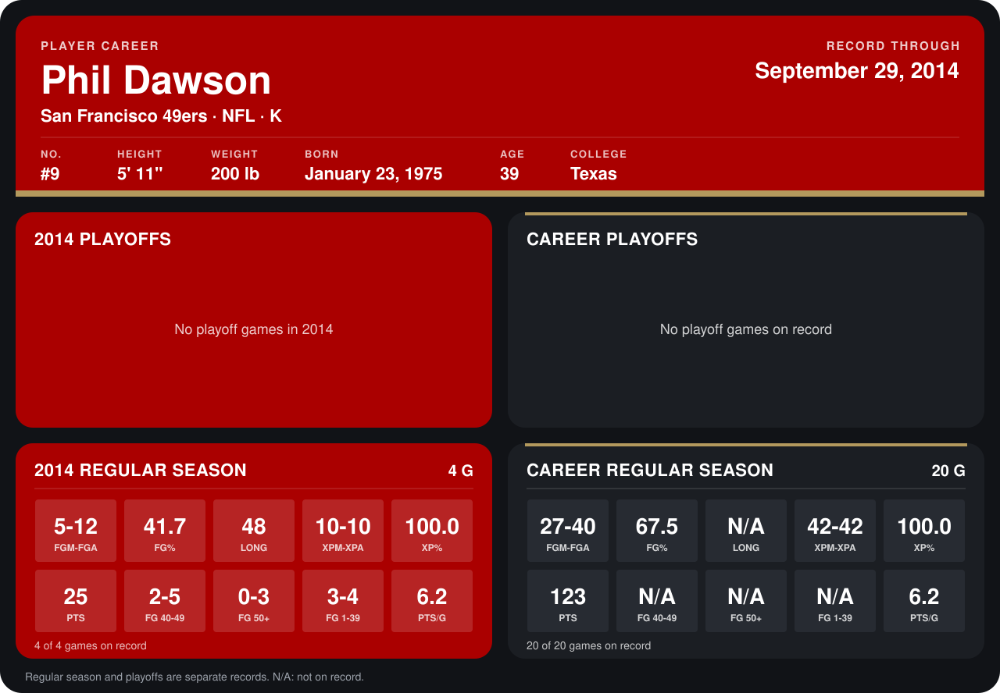

# Phil Dawson

## Career stats

### Regular season

| Season | Club | G | FGM-FGA | FG% | LONG | XPM-XPA | XP% | PTS | FG 40-49 | FG 50+ | FG 1-39 | PTS/G |
|---|---|---:|---:|---:|---:|---:|---:|---:|---:|---:|---:|---:|
| 2013 | San Francisco 49ers | 16 | 22-28 | 78.6 | N/A | 32-32 | 100.0 | 98 | N/A | N/A | N/A | 6.1 |
| 2014 | San Francisco 49ers | 4 | 5-12 | 41.7 | 48 | 10-10 | 100.0 | 25 | 2-5 | 0-3 | 3-4 | 6.2 |
| **Career** |  | 20 | 27-40 | 67.5 | N/A | 42-42 | 100.0 | 123 | N/A | N/A | N/A | 6.2 |

### Playoffs

No playoff games on record.

## Awards

None on record.

Records through September 29, 2014. Identity: listed 2014 roster data, Weeks 1-4; number: 2014 Week 1 roster. [All San Francisco 49ers players](README.md).
