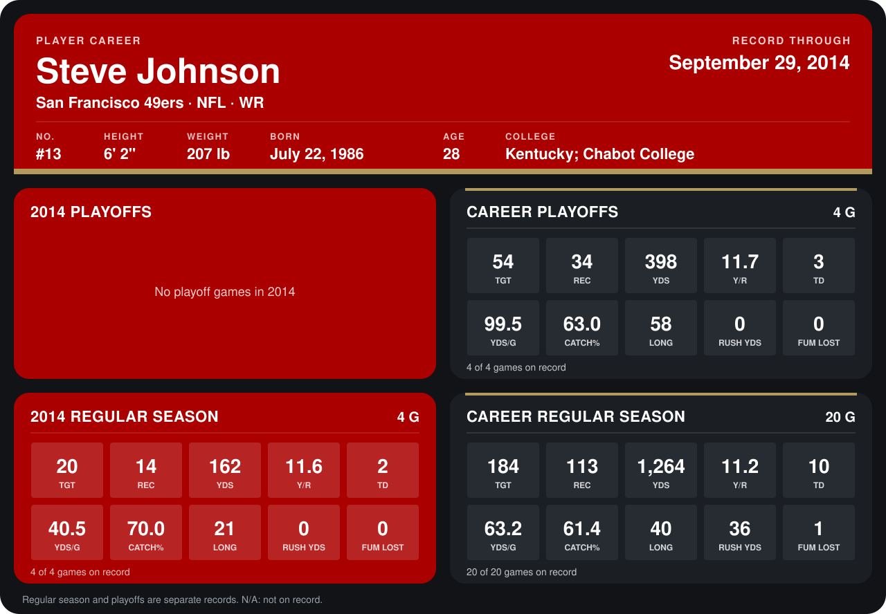

# Steve Johnson

## Career stats

### Regular season

| Season | Team | Age | # | G | TGT | REC | YDS | Y/R | TD | YDS/G | CATCH% | LONG | RUSH YDS | FUM LOST |
|---|---|---:|---:|---:|---:|---:|---:|---:|---:|---:|---:|---:|---:|---:|
| 2013 | Buffalo Bills | 27 | 13 | 16 | 164 | 99 | 1,102 | 11.1 | 8 | 68.9 | 60.4 | 40 | 36 | 1 |
| 2014 | San Francisco 49ers | 28 | 13 | 4 | 20 | 14 | 162 | 11.6 | 2 | 40.5 | 70.0 | 21 | 0 | 0 |
| **Career** |  |  |  | 20 | 184 | 113 | 1,264 | 11.2 | 10 | 63.2 | 61.4 | 40 | 36 | 1 |

### Playoffs

| Season | Team | Age | # | G | TGT | REC | YDS | Y/R | TD | YDS/G | CATCH% | LONG | RUSH YDS | FUM LOST |
|---|---|---:|---:|---:|---:|---:|---:|---:|---:|---:|---:|---:|---:|---:|
| 2013 | Buffalo Bills | 27 | 13 | 4 | 54 | 34 | 398 | 11.7 | 3 | 99.5 | 63.0 | 58 | 0 | 0 |
| **Career** |  |  |  | 4 | 54 | 34 | 398 | 11.7 | 3 | 99.5 | 63.0 | 58 | 0 | 0 |

## Awards

None on record.

Age is his age on the league's opening game of each season; # is the number listed for him that season with that team (2014: the card's rule; 2013: the 2013 season roster), N/A where no listing applies.

Records through September 28, 2014. Identity: listed 2014 roster data, Weeks 1-4; number: 2014 Week 1 roster. [All San Francisco 49ers players](README.md).
