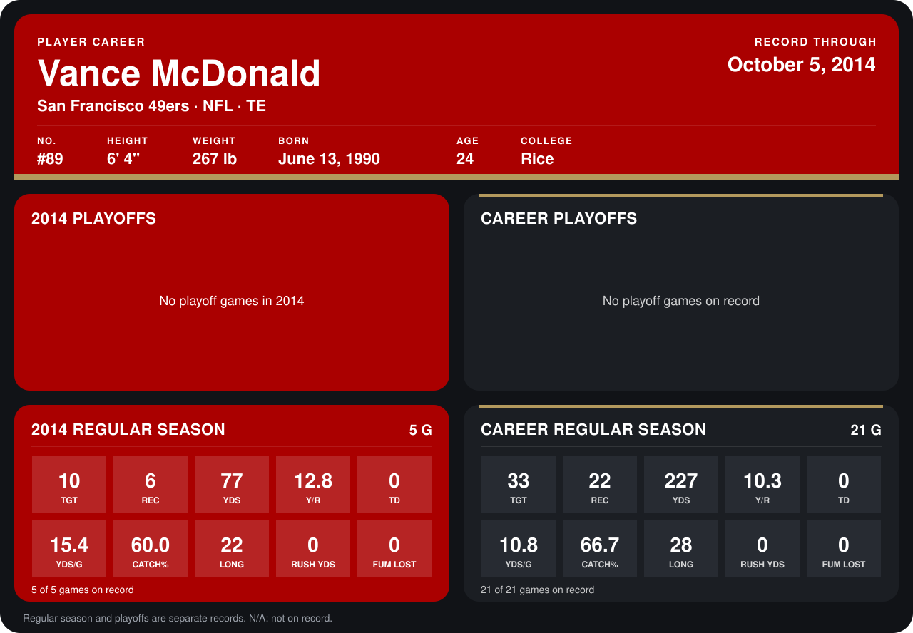

# Vance McDonald

## Career stats

### Regular season

| Season | Team | Age | # | G | TGT | REC | YDS | Y/R | TD | YDS/G | CATCH% | LONG | RUSH YDS | FUM LOST |
|---|---|---:|---:|---:|---:|---:|---:|---:|---:|---:|---:|---:|---:|---:|
| 2013 | San Francisco 49ers | 23 | 89 | 16 | 23 | 16 | 150 | 9.4 | 0 | 9.4 | 69.6 | 28 | 0 | 0 |
| 2014 | San Francisco 49ers | 24 | 89 | 5 | 10 | 6 | 77 | 12.8 | 0 | 15.4 | 60.0 | 22 | 0 | 0 |
| **Career** |  |  |  | 21 | 33 | 22 | 227 | 10.3 | 0 | 10.8 | 66.7 | 28 | 0 | 0 |

### Playoffs

No playoff games on record.

## Awards

None on record.

Age is his age on the league's opening game of each season; # is the number listed for him that season with that team (2014: the card's rule; 2013: the 2013 season roster), N/A where no listing applies.

Records through October 5, 2014. Identity: listed 2014 roster data, Weeks 1-4; number: 2014 Week 1 roster. [All San Francisco 49ers players](README.md).
