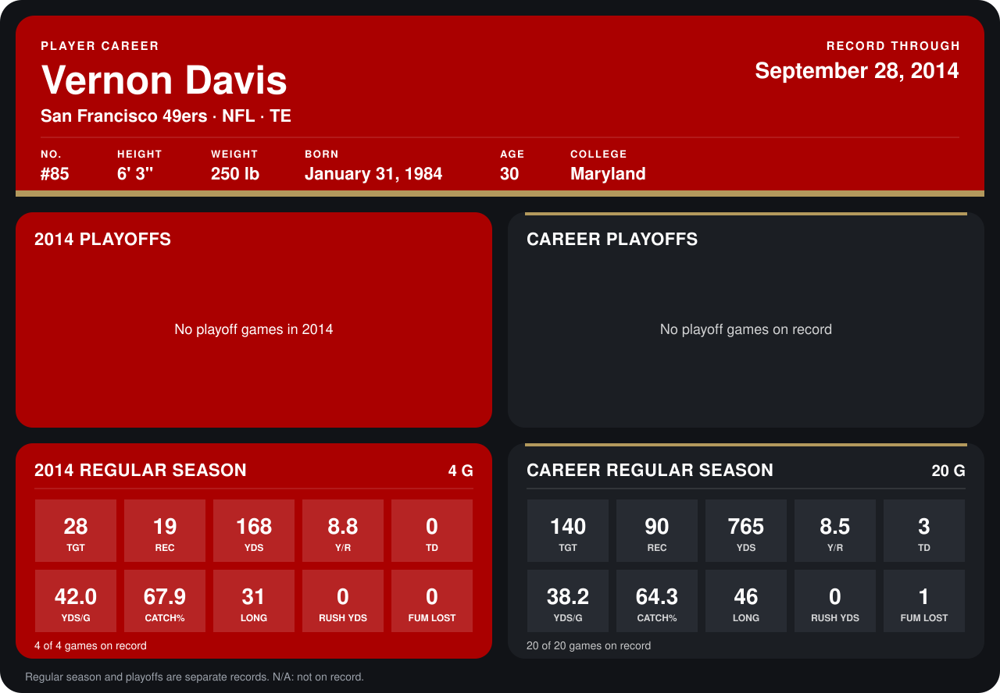

# Vernon Davis

## Career stats

### Regular season

| Season | Club | G | TGT | REC | YDS | Y/R | TD | YDS/G | CATCH% | LONG | RUSH YDS | FUM LOST |
|---|---|---:|---:|---:|---:|---:|---:|---:|---:|---:|---:|---:|
| 2013 | San Francisco 49ers | 16 | 112 | 71 | 597 | 8.4 | 3 | 37.3 | 63.4 | 46 | 0 | 1 |
| 2014 | San Francisco 49ers | 4 | 28 | 19 | 168 | 8.8 | 0 | 42.0 | 67.9 | 31 | 0 | 0 |
| **Career** |  | 20 | 140 | 90 | 765 | 8.5 | 3 | 38.2 | 64.3 | 46 | 0 | 1 |

### Playoffs

No playoff games on record.

## Awards

None on record.

Records through September 29, 2014. Identity: listed 2014 roster data, Weeks 1-4; number: 2014 Week 1 roster. [All San Francisco 49ers players](README.md).
