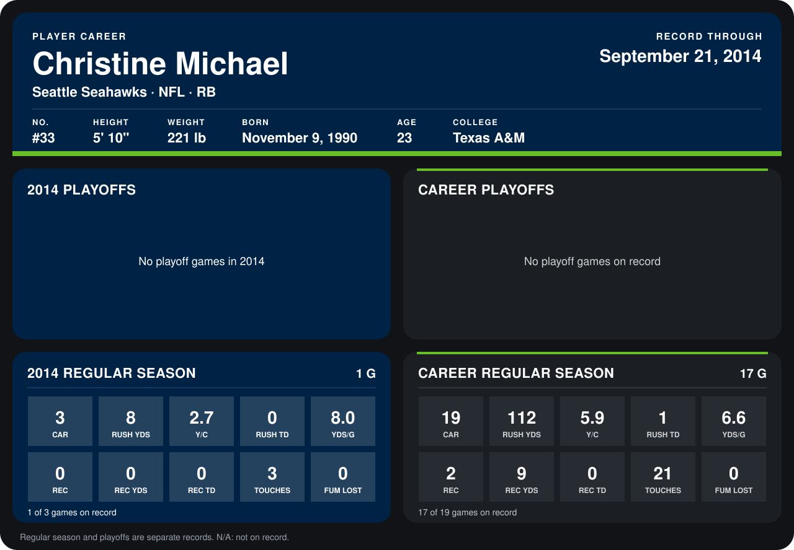

# Christine Michael

## Career stats

### Regular season

| Season | Team | Age | # | G | CAR | RUSH YDS | Y/C | RUSH TD | YDS/G | REC | REC YDS | REC TD | TOUCHES | FUM LOST |
|---|---|---:|---:|---:|---:|---:|---:|---:|---:|---:|---:|---:|---:|---:|
| 2013 | Seattle Seahawks | 22 | 33 | 16 | 16 | 104 | 6.5 | 1 | 6.5 | 2 | 9 | 0 | 18 | 0 |
| 2014 | Seattle Seahawks | 23 | 33 | 1 | 3 | 8 | 2.7 | 0 | 8.0 | 0 | 0 | 0 | 3 | 0 |
| **Career** |  |  |  | 17 | 19 | 112 | 5.9 | 1 | 6.6 | 2 | 9 | 0 | 21 | 0 |

### Playoffs

No playoff games on record.

## Awards

None on record.

Age is his age on the league's opening game of each season; # is the number listed for him that season with that team (2014: the card's rule; 2013: the 2013 season roster), N/A where no listing applies.

Records through September 21, 2014. Identity: listed 2014 roster data, Weeks 1-4; number: 2014 Week 1 roster. [All Seattle Seahawks players](README.md).
