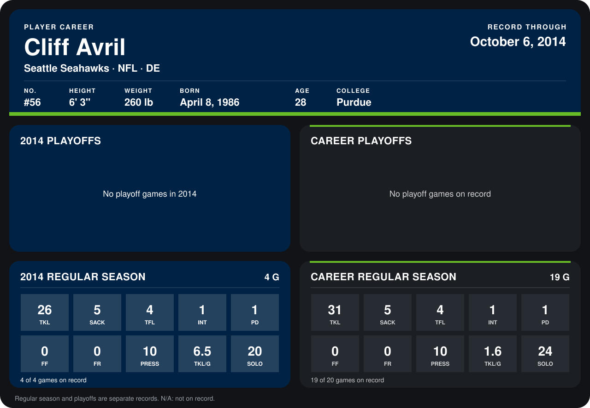

# Cliff Avril

## Career stats

### Regular season

| Season | Club | G | TKL | SACK | TFL | INT | PD | FF | FR | PRESS | TKL/G | SOLO |
|---|---|---:|---:|---:|---:|---:|---:|---:|---:|---:|---:|---:|
| 2013 | Seattle Seahawks | 15 | 5 | 0 | 0 | 0 | 0 | 0 | 0 | 0 | 0.3 | 4 |
| 2014 | Seattle Seahawks | 4 | 26 | 5 | 4 | 1 | 1 | 0 | 0 | 10 | 6.5 | 20 |
| **Career** |  | 19 | 31 | 5 | 4 | 1 | 1 | 0 | 0 | 10 | 1.6 | 24 |

### Playoffs

No playoff games on record.

## Awards

None on record.

Records through October 6, 2014. Identity: listed 2014 roster data, Weeks 1-4; number: 2014 Week 1 roster. [All Seattle Seahawks players](README.md).
