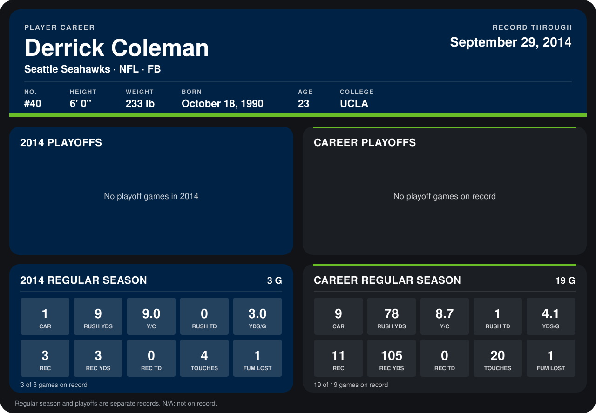

# Derrick Coleman

## Career stats

### Regular season

| Season | Club | G | CAR | RUSH YDS | Y/C | RUSH TD | YDS/G | REC | REC YDS | REC TD | TOUCHES | FUM LOST |
|---|---|---:|---:|---:|---:|---:|---:|---:|---:|---:|---:|---:|
| 2013 | Seattle Seahawks | 16 | 8 | 69 | 8.6 | 1 | 4.3 | 8 | 102 | 0 | 16 | 0 |
| 2014 | Seattle Seahawks | 3 | 1 | 9 | 9.0 | 0 | 3.0 | 3 | 3 | 0 | 4 | 1 |
| **Career** |  | 19 | 9 | 78 | 8.7 | 1 | 4.1 | 11 | 105 | 0 | 20 | 1 |

### Playoffs

No playoff games on record.

## Awards

None on record.

Records through September 29, 2014. Identity: listed 2014 roster data, Weeks 1-4; number: 2014 Week 1 roster. [All Seattle Seahawks players](README.md).
