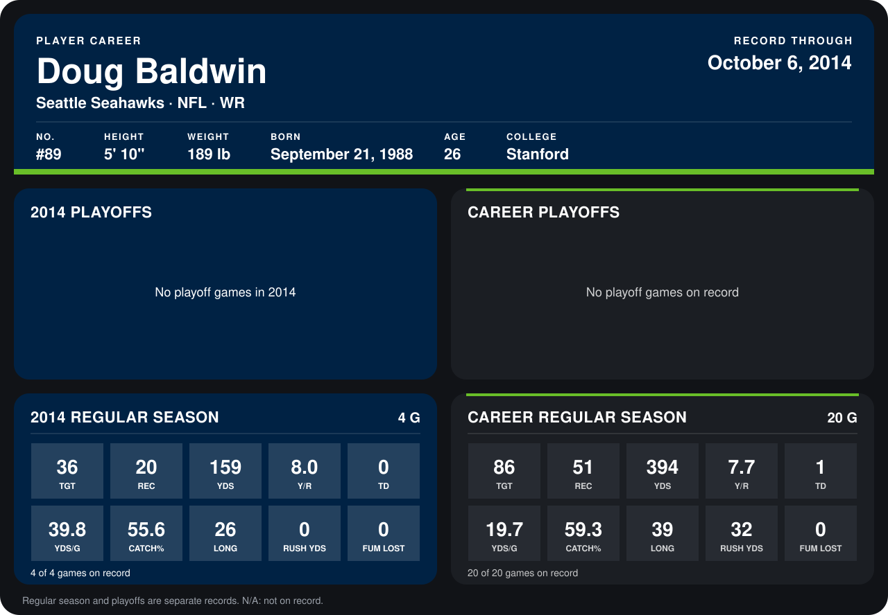

# Doug Baldwin

## Career stats

### Regular season

| Season | Club | G | TGT | REC | YDS | Y/R | TD | YDS/G | CATCH% | LONG | RUSH YDS | FUM LOST |
|---|---|---:|---:|---:|---:|---:|---:|---:|---:|---:|---:|---:|
| 2013 | Seattle Seahawks | 16 | 50 | 31 | 235 | 7.6 | 1 | 14.7 | 62.0 | 39 | 32 | 0 |
| 2014 | Seattle Seahawks | 4 | 36 | 20 | 159 | 8.0 | 0 | 39.8 | 55.6 | 26 | 0 | 0 |
| **Career** |  | 20 | 86 | 51 | 394 | 7.7 | 1 | 19.7 | 59.3 | 39 | 32 | 0 |

### Playoffs

No playoff games on record.

## Awards

None on record.

Records through October 6, 2014. Identity: listed 2014 roster data, Weeks 1-4; number: 2014 Week 1 roster. [All Seattle Seahawks players](README.md).
