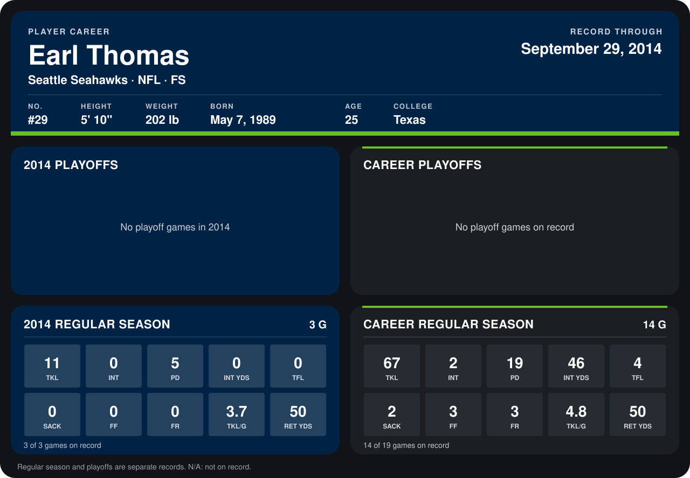

# Earl Thomas

## Career stats

### Regular season

| Season | Club | G | TKL | INT | PD | INT YDS | TFL | SACK | FF | FR | TKL/G | RET YDS |
|---|---|---:|---:|---:|---:|---:|---:|---:|---:|---:|---:|---:|
| 2013 | Seattle Seahawks | 11 | 56 | 2 | 14 | 46 | 4 | 2 | 3 | 3 | 5.1 | 0 |
| 2014 | Seattle Seahawks | 4 | 14 | 0 | 6 | 0 | 0 | 0 | 0 | 0 | 3.5 | 59 |
| **Career** |  | 15 | 70 | 2 | 20 | 46 | 4 | 2 | 3 | 3 | 4.7 | 59 |

### Playoffs

No playoff games on record.

## Awards

- NFC Defensive Player of the Week (2013, Week 7)

Records through October 6, 2014. Identity: listed 2014 roster data, Weeks 1-4; number: 2014 Week 1 roster. [All Seattle Seahawks players](README.md).
